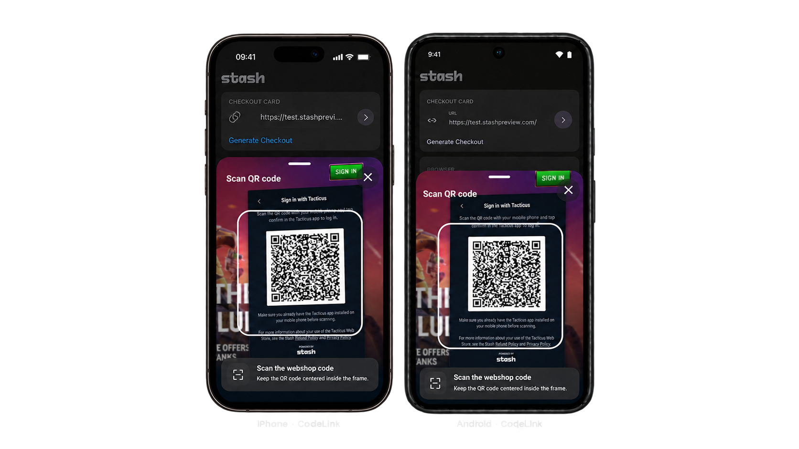

# Stash Native [](https://github.com/stashgg/stash-native/actions/workflows/lint.yml) [](https://github.com/stashgg/stash-native/actions/workflows/main.yml)


<p align="left">
  
</p>

The stash-native package adds Stash Pay in-app purchases (IAPs) and Stash webshop authentication to native games and apps. It presents checkout in a responsive native card or the platform browser and sends payment and lifecycle callbacks to your app. The CodeLink feature scans webshop QR codes inside your app to link accounts. To integrate Stash into web pages or web applications, use [stash-web](https://github.com/stashgg/stash-web) instead.

### Game Engine Wrappers

Unity and Unreal bindings for this library live in separate repositories. Use them to integrate Stash into those engines.

|                                                                                         | Engine        | Repository                                          |
| --------------------------------------------------------------------------------------- | ------------- | --------------------------------------------------- |
|           | Unity         | [stash-unity](https://github.com/stashgg/stash-unity)   |
|  | Unreal Engine | [stash-unreal](https://github.com/stashgg/stash-unreal) |

### Downloads

Prebuilt binaries are available on the [Releases page](https://github.com/stashgg/stash-native/releases):

- **Android**: `StashNative-<tag>.aar`
- **iOS**: `StashNative-<tag>.xcframework.zip`

### Sample Apps

Run `./gradlew :sample:installDebug` from [`Android/`](Android/), or open the [iOS sample project](iOS/Sample/StashNativeSample/StashNativeSample.xcodeproj) in Xcode.

To test the in-app checkout card quickly, use the [callback test page](https://test.stashpreview.com/). It can trigger each checkout callback.

## Installation

### Android

Minimum Android: API 21. The SDK builds with JDK 17 and compile SDK 34.

1. Download `StashNative-<tag>.aar` from [GitHub Releases](https://github.com/stashgg/stash-native/releases) and add it to your project, for example under `libs/`.
2. Add the AAR and its base runtime dependencies to your app's `build.gradle`:

```groovy
dependencies {
    implementation files('libs/StashNative-<tag>.aar')
    implementation 'androidx.core:core:1.12.0'
    implementation 'androidx.webkit:webkit:1.11.0'
    implementation 'androidx.window:window:1.4.0'
    implementation 'androidx.window:window-java:1.4.0'
}
```

Optional dependencies:

```groovy
dependencies {
    // openBrowser and external payments in Chrome Custom Tabs:
    implementation 'androidx.browser:browser:1.7.0'

    // Only for CodeLink QR scanning (include all four):
    implementation 'androidx.camera:camera-camera2:1.4.2'
    implementation 'androidx.camera:camera-lifecycle:1.4.2'
    implementation 'androidx.camera:camera-view:1.4.2'
    implementation 'com.google.zxing:core:3.5.3'
}
```

AAR integrations must declare the base dependencies and any optional groups they use. Source-module integrations inherit the base dependencies. See the [installation guide](https://stashgg.github.io/stash-native/usage/installation.html#android) for details.

### iOS

Minimum iOS: 15.0. Build with Xcode 27.1 for iPhone Duo APIs and compatibility. The host app must also link against the iOS 27.1 SDK to adopt the new iPhone Duo display behavior.

**XCFramework:** Download `StashNative-<tag>.xcframework.zip` from [GitHub Releases](https://github.com/stashgg/stash-native/releases), unzip it, and add `StashNative.xcframework` to your Xcode project. Under **Frameworks, Libraries, and Embedded Content**, set it to **Embed & Sign**.

**Swift Package Manager:** In Xcode, choose **File > Add Package Dependencies**, enter `https://github.com/stashgg/stash-native.git`, and add the **StashNative** library to your target.

For CodeLink, add `NSCameraUsageDescription` to your app's `Info.plist`.

## Features

### OpenCard

Open generated Stash Pay checkout links in a responsive native card that adapts to phones, tablets, foldables, and multitasking, with purchase lifecycle callbacks delivered to your app.


[Usage and configuration](https://stashgg.github.io/stash-native/usage/checkout-card.html) · [Callbacks](https://stashgg.github.io/stash-native/usage/checkout-card.html#handle-the-result)

### OpenBrowser

Open Stash Pay checkout and pre-authenticated Stash Webshop links in Chrome Custom Tabs on Android or Safari View Controller on iOS. Checkout results return through deep links.


[Usage and configuration](https://stashgg.github.io/stash-native/usage/browser.html) · [Returning to the game](https://stashgg.github.io/stash-native/usage/browser.html#return-to-the-game) · [Callbacks](https://stashgg.github.io/stash-native/usage/browser.html#browser-dismissed)

### CodeLink

Scan webshop QR codes in a native card and receive the scanned content to link an account.



[Setup and configuration](https://stashgg.github.io/stash-native/usage/codelink.html) · [Callbacks](https://stashgg.github.io/stash-native/usage/codelink.html#callbacks)

## Documentation

[Full reference](https://stashgg.github.io/stash-native/) · [Callbacks](https://stashgg.github.io/stash-native/usage/callbacks.html) · [Engine wrappers](https://stashgg.github.io/stash-native/usage/engine-wrappers.html) · [JavaScript bridge](https://stashgg.github.io/stash-native/stash-sdk-js.html) · [Changelog](CHANGELOG.md)

## Support

- Documentation: [docs.stash.gg](https://docs.stash.gg)
- Email: [developers@stash.gg](mailto:developers@stash.gg)
