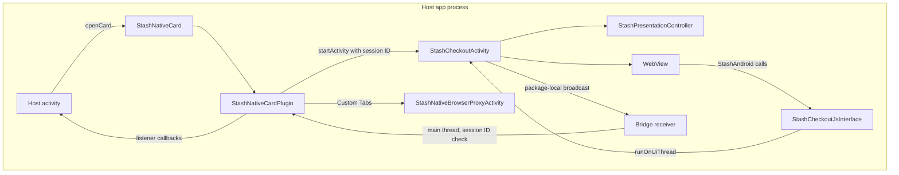
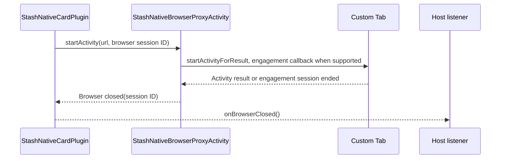

# Android architecture

The Android SDK is a Java library in [`Android/stashnative`](https://github.com/stashgg/stash-native/tree/main/Android/stashnative), package `com.stash.stashnative`. It compiles with Java 8 source compatibility against compile SDK 34 and supports API 21 and later.

## Source map

| Class | Responsibility |
|---|---|
| `StashNativeCard` | Public facade; config, listener, and error types |
| `StashNativeCardPlugin` | Internal coordinator: session admission and IDs, listener dispatch, bridge receiver, browser launch and close tracking, keep-alive, backdrop hand-off |
| `StashCheckoutActivity` | Non-exported activity in the host process. Hosts one card or CodeLink session. |
| `StashPresentationController` | Insets, keyboard, fold information, layout, animation, gestures, telemetry geometry |
| `StashPresentationOptions` | Immutable, normalized config snapshot carried in the launch `Intent` |
| `StashPresentationState` | Selected state, keyboard flag, measured content height |
| `StashCheckoutSizing` | Pure geometry: pane selection around hinges, card frame, resting and expanded heights |
| `StashSheetLayout` | Card container with rounded outline clipping |
| `StashCheckoutWebViewSupport` | WebView creation, deferred first load, bridge injection, provider Home button |
| `StashCheckoutWebViewClient` | Navigation callbacks, load errors, renderer loss |
| `StashCheckoutNavigationSupport` | Deep links, `intent://` URIs, new windows |
| `StashCheckoutLoadingSupport` | Stall retry and deadline timers, loading cover, page-loaded event |
| `StashContentRevealSupport` | Readiness check before the first reveal |
| `StashContentSizeSupport` | Content measurement with document and viewport validation |
| `StashTelemetrySupport` | `getTelemetry()` |
| `StashWebInteractionSupport` | Viewport lock, selection and callout suppression |
| `StashCheckoutJsInterface` | `@JavascriptInterface` methods exposed as `StashAndroid` |
| `StashWebViewUtils` | Bridge script, URL normalization, `theme` parameter, WebView settings |
| `StashCheckoutBridge` | Session-tagged broadcasts from the activity to the plugin |
| `StashUrlLauncher`, `StashCustomTabsEngagement`, `StashNativeBrowserProxyActivity` | Custom Tabs through reflection, engagement signals, result handling, `ACTION_VIEW` fallback |
| `StashKeepAliveService` | Optional `shortService` foreground service during browser sessions |
| `StashHostBackdropSupport` | Portrait backdrop decoding, rotation, cropping |
| `StashCodeLinkSession`, `StashCodeLinkSupport`, `StashCodeLinkView`, `StashCodeLinkDecoder`, `StashCodeLinkOptions` | CodeLink dependency isolation, CameraX binding, UI, QR decoding, options |
| `StashWindowCompat`, `StashBackgroundColorUtils`, `CardConstants` | Window compatibility helpers, colors, constants |

`StashNativeCardPlugin` is a public Java class for historical reasons. Treat it as internal; integrate through `StashNativeCard`.

## Components and event flow

- Each accepted open increments `presentationSessionId`. The ID travels in the launch `Intent` and in every broadcast. The plugin drops events whose ID no longer matches, so a late event from a closed card cannot reach the next session.
- Broadcasts use `Intent.setPackage(<host package>)`. On API 33+ the receiver is registered with `RECEIVER_NOT_EXPORTED`. On API 21 to 32 it requires `<applicationId>.permission.STASH_NATIVE_INTERNAL`, a signature-level permission declared in the SDK manifest.
- The receiver uses platform `registerReceiver` directly, so hosts with an old `androidx.core` (common in Unity builds) do not hit `NoSuchMethodError`.
- Checkout must run in the host process. The manifest uses `tools:remove="android:process"` on both SDK activities. A separate process causes WebView data directory lock conflicts and crashes host `Application` classes that are not multi-process safe.

## Activity configuration

| Attribute | Value | Effect |
|---|---|---|
| `android:exported` | `false` | Only the host app can start it |
| `android:configChanges` | `orientation`, `screenSize`, `smallestScreenSize`, `screenLayout`, `keyboard`, `keyboardHidden`, `uiMode`, `density`, `fontScale`, `layoutDirection` | Resizes in place. The WebView and form state survive rotation, folding, and multi-window changes. |
| `android:screenOrientation` | `behind` | Follows the host activity unless portrait is requested |
| `android:windowSoftInputMode` | `adjustResize` | IME insets drive the layout |
| Theme | `StashNativeCardTheme`, transparent window, edge-to-edge | The card draws its own dimmed backdrop |

- Portrait is requested at runtime only when `orientationPreference` is portrait, `smallestScreenWidthDp < 600`, and the activity is not in multi-window mode. The request is released and restored as those conditions change. CodeLink never requests portrait.
- Back uses `OnBackInvokedCallback` on API 33+ and `onBackPressed` below. Both are user dismissal: they honor `allowDismiss` and the processing lock.
- The activity is never restored from saved state, so a checkout POST is never replayed. If the system recreates it, it finishes immediately and reports a dismissal unless a terminal callback was already sent. After process death, the new process receives no callback.

## Layout

- Insets: system bars and display cutout define the safe region. The IME inset and `WindowInsetsAnimationCompat` progress drive keyboard layout.
- Folds: `WindowInfoTracker` (WindowManager 1.4.0 through the `window-java` callback adapter) reports display features. A `FoldingFeature` that is separating, or that fully occludes, splits the window into two panes. The card uses the larger pane. On a tie it uses the lower pane for a horizontal hinge, and the trailing pane for a vertical hinge.
- Placement: panes narrower than 600 dp get a bottom-attached card at full pane width. Wider panes get a centered card at the preferred width.
- Bottom-attached cards and their WebView extend through the navigation bar area to the window's bottom edge. That strip is added below the usable content height, so the card's top edge does not move. The WebView receives only the bottom navigation inset for the overlap; other insets are cleared to prevent double spacing. An open keyboard replaces the bottom edge. A card above a separating hinge stays inside its pane.
- The card is a single `StashSheetLayout` with a 28 dp rounded outline, outline clipping, and 24 dp elevation. On API 21 and 22 the WebView uses a hardware layer so the renderer honors the rounded outline.
- Height animations update the WebView layout every frame so the viewport and scroll position stay correct. This is a known cost; an earlier pin-and-clip approach failed. Changes here need measured evidence.

## Gestures

| Input | Behavior |
|---|---|
| Handle tap (72 x 48 dp target, ripple) | Toggles resting and expanded |
| Handle drag | Resizes between resting and expanded. A release faster than 400 dp/s picks the stop in that direction; slower releases pick the nearer stop. With `allowDismiss`, dragging more than 100 dp below the resting position, or more than 20 dp with a downward fling faster than 700 dp/s, dismisses. |
| Upward content drag on a resting bottom-attached card | Moves the card with the finger. Release distance and velocity choose the stop. Reversing can return to resting but cannot dismiss. |
| Downward content drag on an expanded card | Scrolls the page. Never collapses. |
| Content drag on a centered card | Scrolls the page |
| Second finger, window resize, processing start, `expand()`, `collapse()` | Cancels the active card drag |

## WebView

| Item | Value |
|---|---|
| Renderer priority | `RENDERER_PRIORITY_IMPORTANT` on API 26+ |
| Enabled | JavaScript, DOM storage, multiple windows (for new-window routing), wide viewport, overview mode, third-party cookies |
| Disabled | File and content access, zoom controls, algorithmic darkening (or `FORCE_DARK_OFF` without AndroidX WebKit) |
| First load | Waits for resolved card bounds so old providers do not lock a wrong initial viewport scale |
| Bridge | `JS_SDK_SCRIPT` evaluated on `onPageStarted`, `onPageCommitVisible` (API 29+), and `onPageFinished` |
| Interaction script | Document start when `DOCUMENT_START_SCRIPT` is supported, otherwise at navigation callbacks |
| Per-document scripts | Content measurement and telemetry, keyed by a random document token |
| Inspection | `WebView.setWebContentsDebuggingEnabled(true)` when `setInspectableWebViewsEnabled(true)` was called. This setting is process-wide. |
| Teardown | Stop loading, remove `StashAndroid`, clear clients, destroy the WebView, flush cookies |

When the current URL contains `klarna`, `paypal`, or `stripe`, the card shows a native Home button at the top start corner. It reloads the initial checkout URL. iOS has no equivalent.

### Navigation policy

| Navigation | Result |
|---|---|
| Non-web scheme containing `stash-pay/success`, `stash-pay/failure`, or `stash-pay/cancel` | Payment success (no order), payment failure, or close request |
| `intent://` URI | Parsed with explicit component and selector removed and `CATEGORY_BROWSABLE` added. Falls back to `browser_fallback_url`, then the package's Play Store listing. |
| Other non-web scheme | `ACTION_VIEW` with `CATEGORY_BROWSABLE`. The card stays open. Missing handlers are ignored. |
| Web-scheme navigation in a subframe | Loads in place |
| New window (`target="_blank"`, `window.open`) | Captured by a temporary transport WebView. `http` and `https` open externally with `openLink` semantics. Other schemes follow the deep link rules above, except that `stash-pay` paths are not treated as results. |

On API 21 to 23 only the legacy `shouldOverrideUrlLoading(WebView, String)` callback runs. It has no frame information, so subframe web navigations cannot be told apart from main-frame ones there. Deep links are still intercepted.

## Browser and close detection

- With `androidx.browser` on the classpath, the invisible proxy activity owns the Custom Tabs result. Hosts do not forward `onActivityResult`. `StashCustomTabsEngagement` detects tabs closed from floating or minimized UI when Chrome supports engagement signals. A second proxy `onResume` without a result is treated as a close.
- Without `androidx.browser`, the URL opens with `ACTION_VIEW`. Close tracking arms when the host pauses, or after 400 ms. `onBrowserClosed` fires after the host stays resumed for 500 ms.
- Custom Tabs classes are loaded through reflection that catches `Throwable`. A missing or old Browser library falls back to `ACTION_VIEW` instead of crashing.

### Keep-alive service

`StashKeepAliveService` is an optional foreground service declared with `foregroundServiceType="shortService"`. When keep-alive is enabled, the SDK starts it before opening a browser and stops it when the host or checkout activity resumes. It shows a low-importance notification built from `KeepAliveConfig`. On API 34+ it starts with `FOREGROUND_SERVICE_TYPE_SHORT_SERVICE` and stops itself on `onTimeout`. It lowers the chance that a low-memory device kills the game during external payment; it does not guarantee process survival.

## CodeLink

- Uses the same activity, sheet, sizing, and presentation controller as checkout. Always follows the host orientation.
- `StashCodeLinkSession` loads `StashCodeLinkSupport` reflectively, so the activity never links CameraX or ZXing types directly. Missing or incompatible libraries produce `CAMERA_CONFIGURATION_FAILED`: the card closes without a dismissal callback and presentation state is released before the error callback. Checkout and browser keep working.
- `StashCodeLinkSupport` owns its own camera lifecycle and binds only its preview and analysis use cases. It never calls `unbindAll`.
- `PreviewView` runs in `COMPATIBLE` (TextureView) mode so the camera honors the card's clipping and transforms. Preview and analysis share a viewport; scan coordinates are remapped after rotation or resizing, and frames from old geometry are dropped.
- Decoding is local ZXing on the Y plane of the scan frame region, on a serial executor. Reconstructed QR corners must lie inside that region. There is no Play Services or model download dependency.
- The first nonempty payload stops capture, shows the Connected confirmation, closes the card, and delivers `onQrCodeScanned` after the activity is destroyed.

## Dependencies and shrinking

| Dependency | Scope in the SDK | Used for |
|---|---|---|
| `androidx.core:core:1.12.0` | `api` | Insets, colors, notifications |
| `androidx.webkit:webkit:1.11.0` | `api` | Document-start scripts, algorithmic darkening control |
| `androidx.window:window:1.4.0`, `window-java:1.4.0` | `implementation` | Fold and display feature information |
| `androidx.browser:browser:1.7.0` | `compileOnly` | Custom Tabs, loaded reflectively |
| `androidx.camera:camera-camera2`, `camera-lifecycle`, `camera-view` 1.4.2 | `compileOnly` | CodeLink camera |
| `com.google.zxing:core:3.5.3` | `compileOnly` | CodeLink QR decoding |

The AAR ships `consumer-rules.pro`. It keeps the public `StashNativeCard` API and its nested types, `@JavascriptInterface` methods, the reflectively loaded Custom Tabs and CodeLink entry points, and the `androidx.browser` members used through reflection. Hosts do not need blanket keep rules.

## Threading

- `openCard`, `codeLink`, `openBrowser`, and `resetPresentationState` post to the main thread when called elsewhere. `StashPresentationOptions` is built on the calling thread first.
- `@JavascriptInterface` methods run on a WebView background thread. `StashCheckoutJsInterface` moves each call to the activity's UI thread and drops it when the session is no longer current.
- Listener callbacks run on the main thread.
- `isCurrentlyPresented` and `presentationSessionId` are `volatile`. The listener reference is strong, so anonymous listeners survive while the app is backgrounded in Custom Tabs.
