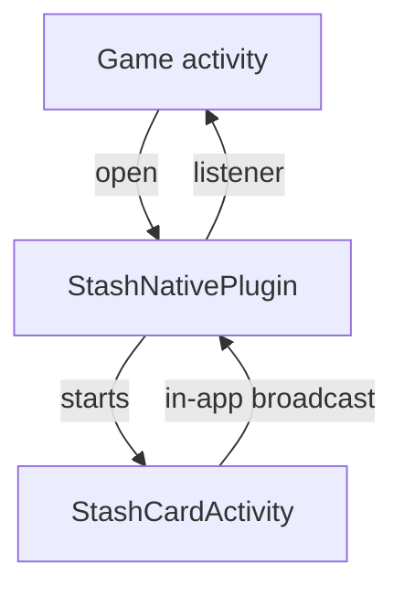

# Android

A Java library for API 21 and later, package `com.stash.stashnative`. Source: [`Android`](https://github.com/stashgg/stash-native/tree/main/Android).

## Structure

`StashNative` forwards to `StashNativePlugin`, which tracks the session and calls the listener. Every card presentation runs in `StashCardActivity`, a non-exported activity in the game's process. The activity reports events through package-local broadcasts tagged with the session ID. Events from an old session are dropped.

| Class | Responsibility |
|---|---|
| `StashNative` | Public API |
| `StashNativePlugin` | Session, listener, system browser, presentation options |
| `StashCardActivity` | Hosts one card presentation |
| `StashPresentationController` | Layout, insets, keyboard, folds, gestures |
| `StashCheckoutWebViewSupport` | WebView setup, loading, errors |
| `StashCheckoutJsInterface` | `StashAndroid` bridge |
| `StashNativeBrowserProxyActivity` | Custom Tabs launch and close detection |

## Layout

- Rotation, folding, and multi-window changes resize the activity in place.
- A separating fold splits the window; the card uses the larger pane.
- Panes narrower than 600 dp get a full-width card at the bottom. The card extends behind the navigation bar, and the WebView ends above it. Wider panes get a centered card.
- Portrait is requested only in compact fullscreen windows. Back counts as a player dismissal.

## WebView

- The bridge script is injected as each page starts and accepts calls from the top document only.
- File access, zoom, and algorithmic darkening are off.
- The first load waits for the final card size, so older WebViews render at the right scale.

## System browser

- Custom Tabs open through an internal proxy activity that detects when the tab closes. The game does not forward `onActivityResult`.
- Without `androidx.browser`, links open with `ACTION_VIEW`, and the close event fires when the launching activity resumes.

## Modules

- Each optional module is a separate AAR or Gradle module with its own dependencies and permissions.
- Module content runs in the same activity and card. The core loads it by reflection through a content contract.
- An open call for a missing module, or a module missing one of its libraries, reports an unavailable error without launching the card.
