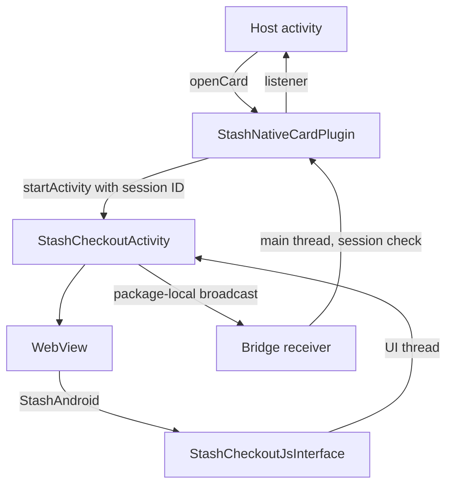
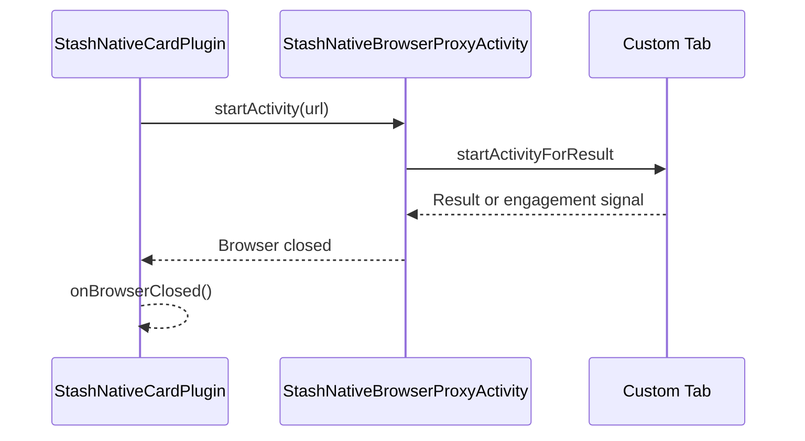

# Android

A Java library for API 21+, package `com.stash.stashnative`, compiled against SDK 34 with Java 8 source compatibility. Source: [`Android/stashnative`](https://github.com/stashgg/stash-native/tree/main/Android/stashnative).

## Source map

| Class | Responsibility |
|---|---|
| `StashNativeCard` | Public API |
| `StashNativeCardPlugin` | Session IDs, listener dispatch, browser launch and close tracking, keep-alive, backdrop |
| `StashCheckoutActivity` | Non-exported activity hosting one card or scanner |
| `StashPresentationController` | Insets, keyboard, folds, layout, animation, gestures |
| `StashCheckoutSizing` | Sizing math and pane selection around hinges |
| `StashCheckoutWebViewSupport`, `StashCheckoutWebViewClient` | WebView setup, navigation callbacks, load errors, renderer loss |
| `StashCheckoutNavigationSupport` | Deep links, `intent://`, new windows |
| `StashCheckoutLoadingSupport`, `StashContentRevealSupport` | Retry and deadline timers, loading cover |
| `StashCheckoutJsInterface`, `StashWebViewUtils` | `StashAndroid` bridge, bridge script, URL validation |
| `StashContentSizeSupport`, `StashTelemetrySupport` | Content measurement, `getTelemetry()` |
| `StashCheckoutBridge` | Broadcasts from the activity to the plugin |
| `StashUrlLauncher`, `StashNativeBrowserProxyActivity`, `StashCustomTabsEngagement` | Custom Tabs and close detection |
| `StashKeepAliveService` | Foreground service during browser sessions |
| `StashCodeLinkSession`, `StashCodeLinkSupport` | Scanner isolation and CameraX binding |

`StashNativeCardPlugin` is public in Java but internal to the SDK.

## Events

- Every accepted open gets a new session ID. Events with an old ID are dropped.
- Broadcasts stay in the app package. The receiver is not exported on API 33+ and needs a signature permission on API 21 to 32.
- Checkout runs in the host process. A separate process breaks the WebView data directory and host `Application` classes.

## Activity

| Attribute | Value | Effect |
|---|---|---|
| `exported` | `false` | Only the host app can start it |
| `configChanges` | Orientation, size, layout, keyboard, UI mode, density, font scale | Rotation, folding, and multi-window resize in place |
| `screenOrientation` | `behind` | Follows the host unless portrait is requested |
| `windowSoftInputMode` | `adjustResize` | The keyboard resizes the layout |

- Portrait is requested only for compact fullscreen windows (`smallestScreenWidthDp < 600`, not multi-window).
- Back counts as user dismissal and respects `allowDismiss` and the processing lock.
- The activity never restores from saved state, so a checkout request is never replayed.

## Layout

- Folds come from WindowManager's `WindowInfoTracker`. A separating fold splits the window; the card uses the larger pane.
- Panes narrower than 600 dp get a full-width card at the bottom. Wider panes get a centered card.
- Bottom cards draw behind the navigation bar. The WebView gets only that bottom inset.
- The card is a rounded, clipped view. API 21 and 22 use a hardware layer to clip the WebView.
- Height animations relayout the WebView every frame. This keeps the viewport correct; replacing it needs measurements.

## Gestures

| Input | Behavior |
|---|---|
| Handle tap | Toggles resting and expanded |
| Handle drag | Resizes. With `allowDismiss`, a drag over 100 dp, or 20 dp with a fast fling, dismisses. |
| Upward drag on a resting bottom card | Expands it |
| Downward drag on content | Scrolls the page |
| Second finger, resize, processing | Cancels the drag |

## WebView

| Item | Value |
|---|---|
| Bridge | `JS_SDK_SCRIPT` on page started, commit visible (API 29+), and page finished |
| Enabled | JavaScript, DOM storage, third-party cookies, multiple windows (to route new windows outside) |
| Disabled | File and content access, zoom, algorithmic darkening |
| First load | Waits for final card size so old WebViews keep the right scale |
| Teardown | Removes `StashAndroid`, destroys the WebView, flushes cookies |

URLs containing `klarna`, `paypal`, or `stripe` show a native Home button that reloads the checkout.

## Browser

- Custom Tabs load through reflection. A missing or old `androidx.browser` falls back to `ACTION_VIEW`.
- With `ACTION_VIEW`, `onBrowserClosed` fires after the host stays resumed for 500 ms.
- The keep-alive service uses the `shortService` foreground type and stops on timeout or when the host resumes.

## CodeLink

- Runs in the same activity and card as checkout, following the host orientation.
- The scanner class loads through reflection, so a missing CameraX or ZXing only fails CodeLink.
- It binds only its own CameraX use cases and never calls `unbindAll`.
- ZXing decodes the scan frame region locally. No Play Services.

## Dependency scopes

Core and WebKit are `api`. WindowManager is `implementation`. Browser, CameraX, and ZXing are `compileOnly`. The AAR ships R8 rules for the public API, bridge methods, and reflection entry points.
