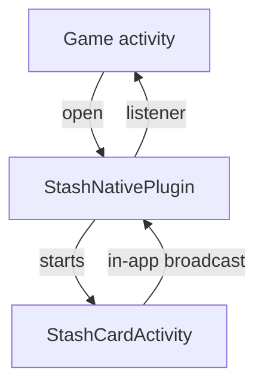

# Android

A Java library for API 21 and later, package `com.stash.stashnative`. Source: [`Android/stashnative`](https://github.com/stashgg/stash-native/tree/main/Android/stashnative).

## Structure

`StashNative` forwards to `StashNativePlugin`, which tracks the session and calls the listener. Each card or scanner runs in `StashCardActivity`, a non-exported activity in the game's process. The activity reports events through package-local broadcasts tagged with the session ID, so events from an old session are dropped.

| Class | Responsibility |
|---|---|
| `StashNative` | Public API |
| `StashNativePlugin` | Session, listener, browser, keep-alive, backdrop |
| `StashCardActivity` | Hosts one card or scanner |
| `StashPresentationController` | Layout, insets, keyboard, folds, gestures |
| `StashCheckoutWebViewSupport` | WebView setup, loading, errors |
| `StashCheckoutJsInterface` | `StashAndroid` bridge |
| `StashNativeBrowserProxyActivity` | Custom Tabs launch and close detection |
| `StashScannerContent`, `StashScannerHost` | Scanner contract; the implementation lives in the `stashnative-codelink` module |

## Layout

- Rotation, folding, and multi-window changes resize the activity in place.
- A separating fold splits the window; the card uses the larger pane.
- Panes narrower than 600 dp get a full-width card at the bottom, drawn behind the navigation bar. Wider panes get a centered card.
- Portrait is requested only in compact fullscreen windows. Back counts as a player dismissal.

## WebView

- The bridge script is injected as each page starts and accepts calls from the top document only.
- File access, zoom, and algorithmic darkening are off.
- The first load waits for the final card size, so older WebViews render at the right scale.

## Browser

- Custom Tabs open through an internal proxy activity that detects when the tab closes. The game does not forward `onActivityResult`.
- Without `androidx.browser`, links open with `ACTION_VIEW`, and browser dismissed fires when the launching activity resumes.
- The optional keep-alive service is a short foreground service that stops when the game resumes.

## QR scanner

The scanner runs in the same activity and card as checkout, but its code lives in the optional `stashnative-codelink` module, which carries CameraX, ZXing and the camera permission. The core resolves the module's `StashScannerSupport` by reflection through the `StashScannerContent` and `StashScannerHost` contracts. Without the module, `openScanner` closes with `SCANNER_UNAVAILABLE`; if a host strips the permission, the scanner stays open with `CAMERA_PERMISSION_NOT_DECLARED`. Decoding runs on the device.
