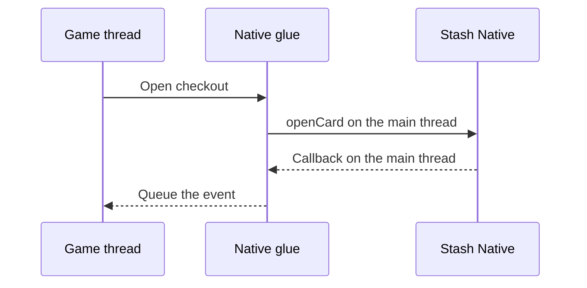

# Engine Wrappers

Unity and Unreal Engine games use the official wrappers: [stash-unity](https://github.com/stashgg/stash-unity) and [stash-unreal](https://github.com/stashgg/stash-unreal). For another engine, add a small native glue file per platform that forwards calls to the SDK and events back to the engine.



## Rules

1. Pass the engine's current activity or root view controller to open calls.
2. Set the receiver on the main thread before the first open, and clear it there on shutdown.
3. Copy each callback payload and queue it for the game thread.
4. Forward every callback, in order.
5. Leave orientation to the SDK.

## Android

```java
import android.app.Activity;
import android.os.Handler;
import android.os.Looper;
import com.stash.stashnative.StashNative;

public final class StashWrapper extends StashNative.StashNativeListenerAdapter {
    private static final StashWrapper INSTANCE = new StashWrapper();
    private static final Handler MAIN = new Handler(Looper.getMainLooper());

    // Implemented in engine code; queues the event for the game thread.
    private static native void nativeOnEvent(String name, String payload);

    public static void initialize() {
        MAIN.post(() -> StashNative.getInstance().setListener(INSTANCE));
    }

    public static void openCard(Activity activity, String url) {
        MAIN.post(() -> StashNative.getInstance().openCard(activity, url, null));
    }

    @Override public void onPaymentSuccess(String order) { nativeOnEvent("paymentSuccess", order); }
    @Override public void onCardDismissed() { nativeOnEvent("cardDismissed", null); }
    // Forward the other events the same way.
}
```

| Engine | Activity | Event delivery |
|---|---|---|
| Unity | `UnityPlayer.currentActivity` | `UnityPlayer.UnitySendMessage(gameObject, method, payload)` |
| Unreal Engine | `FJavaWrapper::GameActivityThis` | JNI method that calls `AsyncTask(ENamedThreads::GameThread, ...)` |

Declare the AAR's [dependencies](../usage/installation.md#android) in an External Dependency Manager file (Unity) or in UPL `<buildGradleAdditions>` (Unreal).

## iOS

```objc
#import <StashNative/StashNative.h>

typedef void (*StashEventCallback)(const char *name, const char *payload);
static StashEventCallback gCallback;  // Copies the payload and queues it for the game thread.
extern UIViewController *StashEnginePresenter(void);  // Supplied per engine.

@interface StashWrapperDelegate : NSObject <StashNativeDelegate>
@end

@implementation StashWrapperDelegate
- (void)stashNativeDidCompletePaymentWithOrder:(NSString *)order {
    if (gCallback) gCallback("paymentSuccess", order.UTF8String);
}
- (void)stashNativeDidDismissCard {
    if (gCallback) gCallback("cardDismissed", NULL);
}
// Forward the other events the same way.
@end

static StashWrapperDelegate *gDelegate;  // Strong owner; the SDK does not retain the delegate.

extern "C" void StashWrapperInitialize(StashEventCallback callback) {
    dispatch_async(dispatch_get_main_queue(), ^{
        gCallback = callback;
        if (!gDelegate) gDelegate = [[StashWrapperDelegate alloc] init];
        [StashNative sharedInstance].delegate = gDelegate;
    });
}

extern "C" void StashWrapperOpenCard(const char *url) {
    NSString *checkoutURL = url ? [NSString stringWithUTF8String:url] : nil;
    dispatch_async(dispatch_get_main_queue(), ^{
        [[StashNative sharedInstance] openCardWithURL:checkoutURL
                                   fromViewController:StashEnginePresenter()
                                               config:nil];
    });
}
```

| Engine | Presenter | Event delivery |
|---|---|---|
| Unity | `UnityGetGLViewController()` | `UnitySendMessage(gameObject, method, payload)` |
| Unreal Engine | `[IOSAppDelegate GetDelegate].IOSController` | Copy into an `FString`, then `AsyncTask(ENamedThreads::GameThread, ...)` |

- `StashNative.framework` is dynamic. Embed and sign it.
- The example uses ARC. Unreal compiles Objective-C without ARC unless the module sets `bEnableObjCAutomaticReferenceCounting = true`; the SDK supports both.

## Platform differences

| Behavior | iOS | Android |
|---|---|---|
| `isCurrentlyPresented` while the browser is open | `true` | `false` |
| `openBrowser` while a card is open | Ignored | Opens |
| `closeBrowser()` | Closes Safari | No effect |
| Portrait backdrop, keep-alive service | Not available | Available |
| Portrait Safari, closing Safari with a result | Available | Not available |
