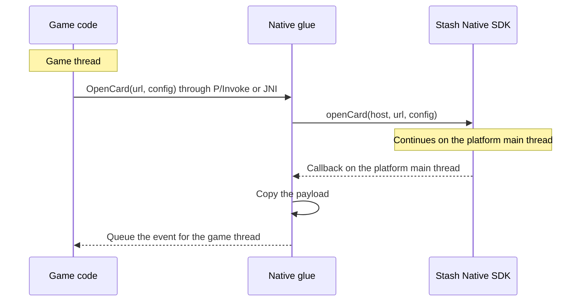

# Engine Wrappers

Unity and Unreal Engine games should use the official wrappers: [stash-unity](https://github.com/stashgg/stash-unity) and [stash-unreal](https://github.com/stashgg/stash-unreal). For another engine, write a small native glue file per platform that forwards calls to the SDK and events back to the engine.



## Rules

1. Pass the engine's current activity or root view controller to every open call, so checkout appears over the game.
2. Use a stable coordinator as the receiver. Register, read, replace, and clear it on main, with registration queued before dependent opens. Keep a strong owner for the iOS delegate; Android retains its listener.
3. Copy each callback payload and queue it for the game thread. Callbacks arrive on the platform main thread, which is not the engine's game thread.
4. Forward every callback, in order. Do not treat engine pause and resume as payment results.
5. Treat `isCurrentlyPresented` as informational. It cannot reserve a slot or confirm admission; busy state, an invalid host, or an invalid URL can silently reject an open.
6. Read `isPurchaseProcessing` for processing state. Reflection on SDK internals breaks between releases.
7. Leave orientation to the SDK. Your own orientation hooks conflict with its portrait handling.

## Android

Compile a listener class into the wrapper's Android library:

```java
import android.app.Activity;
import android.os.Handler;
import android.os.Looper;
import com.stash.stashnative.StashNative;

public final class StashWrapper implements StashNative.StashNativeListener {
    private static final StashWrapper INSTANCE = new StashWrapper();
    private static final Handler MAIN = new Handler(Looper.getMainLooper());

    // Implemented in engine code; queues the event for the game thread.
    private static native void nativeOnEvent(String name, String payload);

    public static void initialize() {
        MAIN.post(() -> StashNative.getInstance().setListener(INSTANCE));
    }

    public static void openCard(Activity activity, String url, boolean portrait) {
        StashNative.CardConfig config = new StashNative.CardConfig();
        config.orientationPreference = portrait
                ? StashNative.CardConfig.ORIENTATION_PORTRAIT
                : StashNative.CardConfig.ORIENTATION_FOLLOW_HOST;
        MAIN.post(() -> StashNative.getInstance().openCard(activity, url, config));
    }

    public static void shutdown() {
        MAIN.post(() -> {
            StashNative sdk = StashNative.getInstance();
            if (sdk.getListener() == INSTANCE) sdk.setListener(null);
        });
    }

    @Override public void onPaymentSuccess(String order) { nativeOnEvent("paymentSuccess", order); }
    @Override public void onPaymentFailure() { nativeOnEvent("paymentFailure", null); }
    @Override public void onCardDismissed() { nativeOnEvent("cardDismissed", null); }
    @Override public void onScanDismissed() { nativeOnEvent("scanDismissed", null); }
    @Override public void onPageLoaded(long ms) { nativeOnEvent("pageLoaded", Long.toString(ms)); }
    @Override public void onNetworkError() { nativeOnEvent("networkError", null); }
    @Override public void onExternalPayment(String url) { nativeOnEvent("externalPayment", url); }
    @Override public void onBrowserDismissed() { nativeOnEvent("browserDismissed", null); }
    @Override public void onQrCodeScanned(String content) { nativeOnEvent("qrScanned", content); }
    @Override public void onCodeLinkError(StashNative.CodeLinkError error) {
        nativeOnEvent("codeLinkError", error.name());
    }
}
```

Call `initialize()` before `openCard()` from the same engine thread so their main-thread posts keep that order. Clear registration only if it still belongs to your receiver. Drain or discard events already queued in the engine before destroying their consumer.

| Engine | Activity | Callback delivery |
|---|---|---|
| Unity | `UnityPlayer.currentActivity` | `UnityPlayer.UnitySendMessage(gameObject, method, payload)` |
| Unreal Engine | `FJavaWrapper::GameActivityThis` | JNI native method that calls `AsyncTask(ENamedThreads::GameThread, ...)` |

- Implement every listener method in a concrete class. Dynamic proxies may skip default methods.
- Declare the AAR's [dependencies](../usage/installation.md#android) in an External Dependency Manager `*Dependencies.xml` file (Unity) or in UPL `<buildGradleAdditions>` (Unreal).
- Read JNI strings with `GetStringChars`. `GetStringUTFChars` returns Modified UTF-8, which differs for emoji in order payloads.

## iOS

Export C functions from an Objective-C++ file and own the delegate there:

```objc
#import <StashNative/StashNative.h>

typedef void (*StashEventCallback)(const char *name, const char *payload);
static StashEventCallback gCallback;  // Copies the payload and queues it for the game thread.

extern UIViewController *StashEnginePresenter(void);  // Supplied per engine.

@interface StashWrapperDelegate : NSObject <StashNativeDelegate>
@end

@implementation StashWrapperDelegate
static void Emit(const char *name, NSString *payload) {
    if (gCallback) gCallback(name, payload.UTF8String);
}
- (void)stashNativeDidCompletePaymentWithOrder:(NSString *)order { Emit("paymentSuccess", order); }
- (void)stashNativeDidFailPayment { Emit("paymentFailure", nil); }
- (void)stashNativeDidDismissCard { Emit("cardDismissed", nil); }
- (void)stashNativeDidDismissScan { Emit("scanDismissed", nil); }
- (void)stashNativeDidLoadPage:(double)ms { Emit("pageLoaded", [NSString stringWithFormat:@"%.0f", ms]); }
- (void)stashNativeDidEncounterNetworkError { Emit("networkError", nil); }
- (void)stashNativeDidRequestExternalPaymentWithURL:(NSString *)url { Emit("externalPayment", url); }
- (void)stashNativeDidDismissBrowser { Emit("browserDismissed", nil); }
- (void)stashNativeDidScanQRCode:(NSString *)content { Emit("qrScanned", content); }
- (void)stashNativeCodeLinkDidEncounterError:(NSError *)error {
    Emit("codeLinkError", [NSString stringWithFormat:@"%ld", (long)error.code]);
}
@end

static StashWrapperDelegate *gDelegate;  // Strong owner.

extern "C" void StashWrapperInitialize(StashEventCallback callback) {
    dispatch_async(dispatch_get_main_queue(), ^{
        gCallback = callback;
        if (!gDelegate) gDelegate = [[StashWrapperDelegate alloc] init];
        [StashNative sharedInstance].delegate = gDelegate;
    });
}

extern "C" void StashWrapperOpenCard(const char *url, bool portrait) {
    NSString *checkoutURL = url ? [NSString stringWithUTF8String:url] : nil;
    dispatch_async(dispatch_get_main_queue(), ^{
        StashNativeCardConfig *config = [[StashNativeCardConfig alloc] init];
        config.orientationPreference = portrait ? StashNativeOrientationPreferencePortrait
                                                : StashNativeOrientationPreferenceFollowHost;
        [[StashNative sharedInstance] openCardWithURL:checkoutURL
                                       fromViewController:StashEnginePresenter()
                                                   config:config];
    });
}

extern "C" void StashWrapperShutdown(void) {
    dispatch_async(dispatch_get_main_queue(), ^{
        StashNative *sdk = [StashNative sharedInstance];
        if (sdk.delegate == gDelegate) sdk.delegate = nil;
        gCallback = NULL;
        gDelegate = nil;
    });
}
```

Call `StashWrapperInitialize` before `StashWrapperOpenCard` from the same engine thread. Both post to main, so registration precedes the open. Wait for shutdown's main-queue work and drain or discard queued engine events before unloading callback code.

| Engine | Presenter | Callback delivery |
|---|---|---|
| Unity | `UnityGetGLViewController()` | `UnitySendMessage(gameObject, method, payload)` |
| Unreal Engine | `[IOSAppDelegate GetDelegate].IOSController` | Copy into an `FString`, then `AsyncTask(ENamedThreads::GameThread, ...)` |

- `StashNative.framework` is dynamic. Embed and sign it. Unreal: `PublicAdditionalFrameworks.Add(new Framework("StashNative", path, null, true))`.
- The example uses ARC. Unreal compiles Objective-C without ARC unless the module sets `bEnableObjCAutomaticReferenceCounting = true`. The SDK supports both modes. Under manual reference counting, clear the SDK's `assign` delegate on main before releasing your owner, and synchronize teardown with callbacks.
- `UTF8String` buffers are autoreleased. Copy them before the callback returns.

## Platform differences

| Behavior | iOS | Android |
|---|---|---|
| `isCurrentlyPresented` during `openBrowser` | `true` | `false` |
| `isCurrentlyPresented` during external payment | `true` until Safari closes | `false` |
| `openBrowser` while a card is open | Ignored | Opens |
| Open call inside a payment callback with `autoClose` | Ignored | Accepted |
| `closeBrowser()` | Closes Safari | No effect |
| Page loaded time measured from | Opening the card | The start of the last page load |
| Portrait backdrop, keep-alive service | Not available | Available |
| Browser orientation, closing Safari with a result | Available | Not available |

Both platforms select the current receiver for each event, including events from already-open flows. Replacement affects future events; clearing does not undo an executing callback or a wrapper's queued event. Reset tears down the card or scanner and SDK tracking silently, preserving registration. It closes Safari on iOS; Android cannot close an already-open Custom Tab or system browser. Payment events can repeat with `autoClose` off, and a payment callback is not a portable signal to open the next presentation. See [callback order](../usage/callbacks.md#order-of-events).
