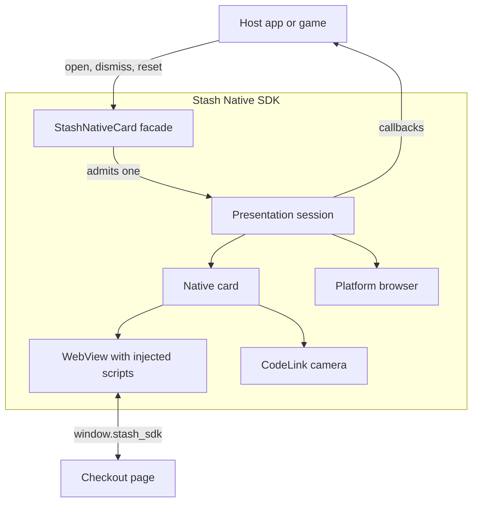
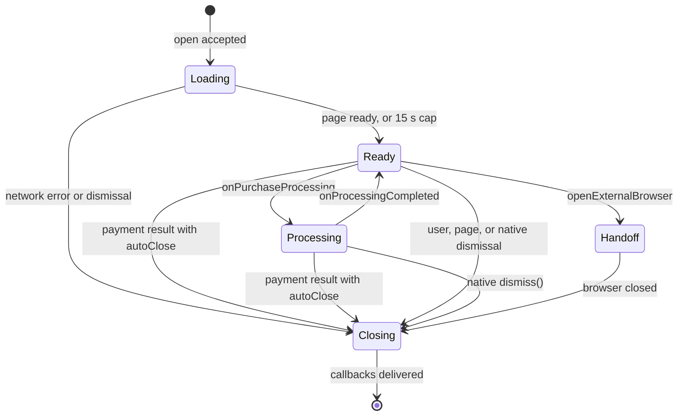
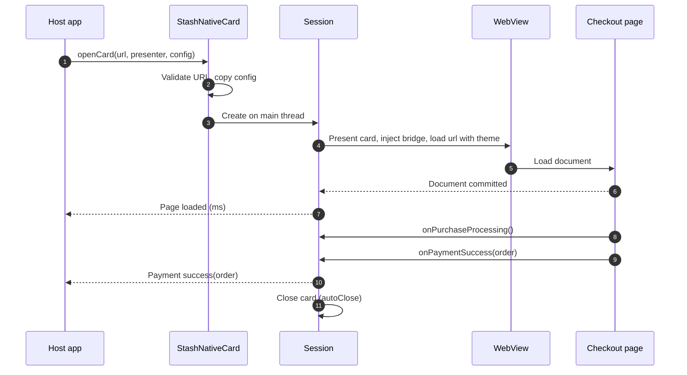
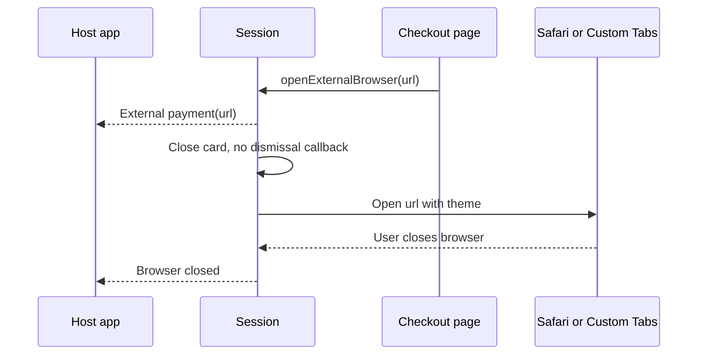

# Platform Architecture

Both SDKs follow one design. A singleton facade admits one presentation session at a time. The session hosts a WebView or camera in a native card and turns `window.stash_sdk` messages into host callbacks. Platform details: [iOS](ios.md), [Android](android.md), [Compatibility](compatibility.md).

## Components

| Layer | iOS | Android |
|---|---|---|
| Facade | `StashNativeCard` | `StashNativeCard`, `StashNativeCardPlugin` |
| Session | `StashCheckoutSession` | Session ID in `StashNativeCardPlugin`, `StashCheckoutActivity` |
| Card | `StashCheckoutViewController` in a `UISheetPresentationController` | `StashCheckoutActivity`, `StashPresentationController` |
| Web content | `WKWebView` with script message handlers | `WebView` with the `StashAndroid` JavaScript interface |
| Browser | `SFSafariViewController` | Custom Tabs through `StashNativeBrowserProxyActivity`, or `ACTION_VIEW` |
| CodeLink | AVFoundation | CameraX and ZXing |

## Session lifecycle

`resetPresentationState()` ends a session in any state without callbacks. During processing only native `dismiss()` can close the card.

## Opening a checkout card

## External payment

## Sizing

Card size comes from the window, never from the device type. A region narrower than 600 points or dp is narrow.

| Value | Rule |
|---|---|
| Available region | Window minus safe area, docked keyboard, and separating folds |
| Margin | `min(edgeMargin, shorter region side / 4)` |
| Width | Narrow: region width. Otherwise `min(preferredContentWidth, region width - 2 * margin)`. |
| Expanded height | Region height minus margins, capped by `maximumContentHeight` when it is above 0 |
| Resting height | `min(preferredContentHeight, expanded height, reported content height)` |
| Placement | Android: bottom-attached when narrow, centered otherwise. iOS: UIKit attaches the sheet in compact size classes and floats it when both size classes are regular. |

The card remembers resting or expanded across resizes. The keyboard forces expanded until it closes. Geometry changes keep the same WebView, document, input, and scroll position, and never reload the page.

## Loading and recovery

| Stage | iOS | Android |
|---|---|---|
| Retry | One reload after 10 s without a 2xx or 304 response | One reload after 10 s without a commit |
| Network error | 15 s of foreground time without a response, or an HTTP error before the first load | 15 s without a commit, or an HTTP error during the first load |
| Reveal | After the page commits and shows content, at most 15 s | After the page commits and finishes, at most 15 s |
| Renderer loss | One reload; a second loss or a loss during processing is a network error | One rebuild after an OS kill (API 26+); a crash, a second loss, or a loss during processing is a network error |
| Failure after load | Closes with the dismissal callback | Closes with the dismissal callback on connection errors |

Background time does not count toward these limits.

## Threading and ownership

| | iOS | Android |
|---|---|---|
| Public calls | Any thread; work moves to the main queue | Any thread; work moves to the main looper |
| Callbacks | Main thread | Main thread |
| Callback receiver | Weak (`assign` without ARC) | Strong |
| Host reference | Weak view controller | Weak activity |
| Event path | Direct calls | Session-tagged broadcasts from the checkout activity to the plugin |
