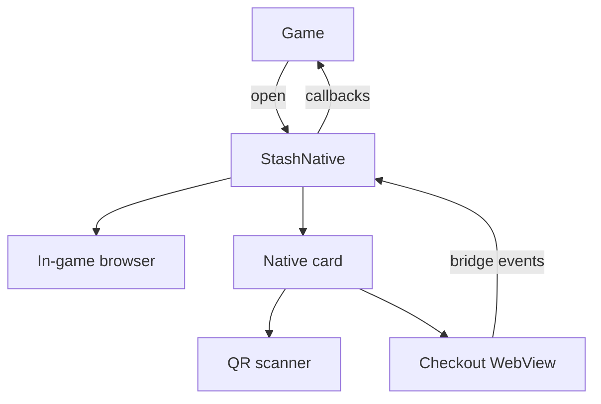
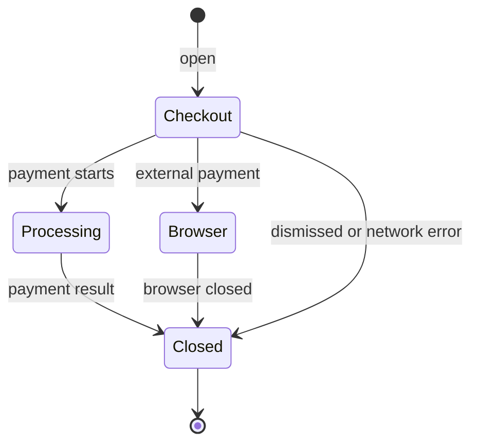

# Package Architecture

Both packages share one design. The `StashNative` singleton runs one presentation at a time: checkout or the QR scanner in a native card, or a page in the in-game browser. Checkout pages talk to the SDK through the internal [JavaScript Bridge](../stash-sdk-js.md), and the SDK reports events to the game as [callbacks](../usage/callbacks.md).

## Components

| Part | iOS | Android |
|---|---|---|
| Facade | `StashNative` | `StashNative` and `StashNativePlugin` |
| Native card | Sheet from `UISheetPresentationController` | `StashCardActivity` |
| Checkout | `WKWebView` | `WebView` |
| In-game browser | `SFSafariViewController` | Chrome Custom Tabs |
| QR scanner | Optional `StashNativeCodeLink` module (AVFoundation) | Optional `stashnative-codelink` module (CameraX and ZXing) |

## Session lifecycle

- Opening a card or scanner while one is active does nothing.
- Players cannot close the card while a payment is processing.
- `resetPresentationState()` ends a session in any state without callbacks.

## Sizing

- The card sizes itself from the current window, not the device type.
- In regions narrower than 600 points or dp, the card uses the full width. Wider regions use up to `preferredContentWidth`.
- The card opens at `preferredContentHeight`, or shorter for short pages, and expands up to `maximumContentHeight`.
- Rotation, folding, window resizing, and the keyboard keep the same WebView and page state.

## Loading

- Checkout reloads once if it has not responded after 10 seconds.
- After 15 seconds of foreground time without a response, the card closes with a network error.
- A lost connection after the page loaded is also a network error.
- If the system stops the WebView's renderer, checkout reloads once. A second loss is a network error.

## Threading

| | iOS | Android |
|---|---|---|
| Open calls | Any thread | Any thread |
| Receiver setup and callbacks | Main thread | Main thread |
| Receiver reference | Weak (`assign` without ARC) | Strong |
