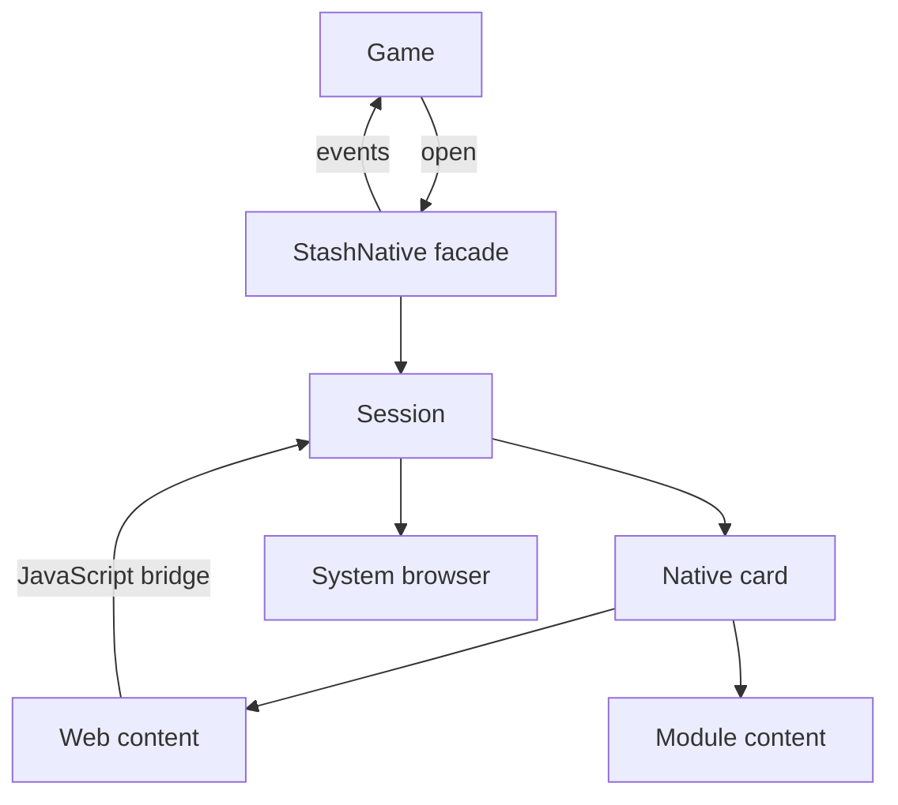
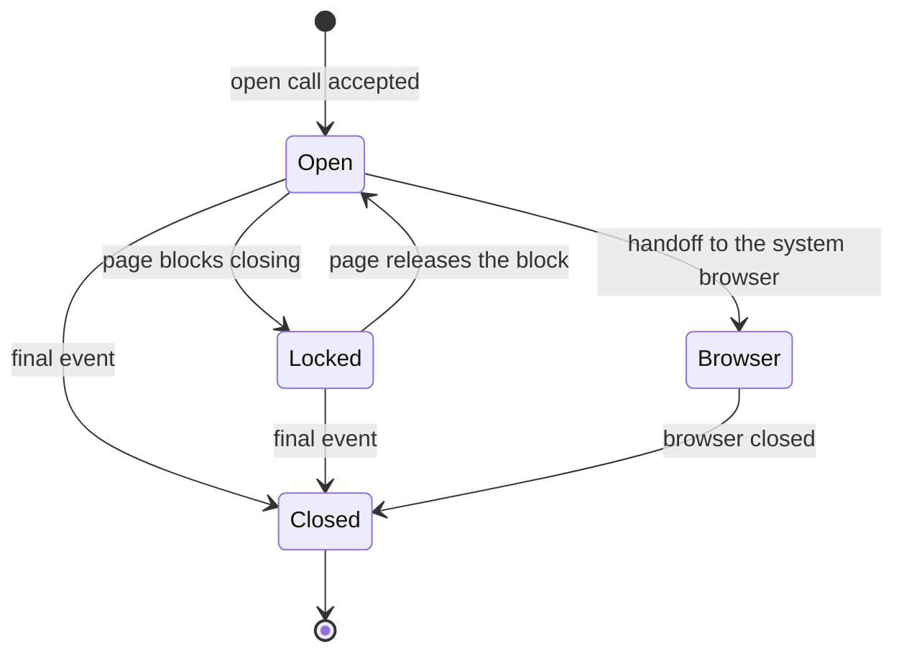

# Package Architecture

iOS and Android share one design: a small core plus optional modules. The `StashNative` facade runs one card or scanner at a time and sends its events to the game's shared [callback receiver](../usage/callbacks.md). Every feature is a presentation built from the parts below.

## Components

| Part | Role | iOS | Android |
|---|---|---|---|
| Facade | Public API; one card or scanner at a time | `StashNative` | `StashNative`, `StashNativePlugin` |
| Session | State and events of the open presentation | `StashCardSession` | Session ID in `StashNativePlugin` |
| Native card | Responsive container over the game | `UISheetPresentationController` sheet | `StashCardActivity` |
| Web content | Stash pages, connected through the [JavaScript Bridge](../stash-sdk-js.md) | `WKWebView` | `WebView` |
| Module content | Native content from an optional module | Separate product, found at runtime | Separate AAR, loaded by reflection |
| System browser | Pages that need a full browser | `SFSafariViewController` | Chrome Custom Tabs |

## Presentation lifecycle

- An open call while a presentation is active does nothing, with one Android exception: `openBrowser` opens a browser over an open card or scanner. That browser ends with its own browser-dismissed event, and the card or scanner stays open.
- While locked, players cannot close the card.
- Every presentation ends with one final event. `resetPresentationState()`, and `dismissSafariViewController()` on iOS, end it without events.

## Native card

- The card sizes itself from the current window, not the device type.
- Regions narrower than 600 points or dp get a full-width card at the bottom. On a phone in landscape the card stays at the bottom, at up to the configured width. Regions that are wide and tall get a floating card, centered.
- The card opens at the configured height and expands up to the configured maximum, both limited by the available space. Page content does not size the card.
- Rotation, folding, window resizing, and the keyboard keep the same content and state.

## Web content loading

- A page reloads once if it has not responded after 10 seconds.
- After 15 seconds of foreground time without a response, the presentation closes with a network error.
- A lost connection after the page loaded is also a network error.
- If the system stops the WebView's renderer, the page reloads once. A second loss is a network error.

## Modules

- Optional modules ship as separate packages, so games add only what they use.
- The core finds a module at runtime through a content contract; games import nothing extra.
- An open call for a missing module reports an unavailable error and presents nothing.

## Threading

| | iOS | Android |
|---|---|---|
| Open calls | Any thread | Any thread |
| Receiver setup and callbacks | Main thread | Main thread |
| `isCurrentlyPresented`, `isPurchaseProcessing` | Main thread | Any thread |
| Receiver reference | Weak (`assign` without ARC) | Strong |
