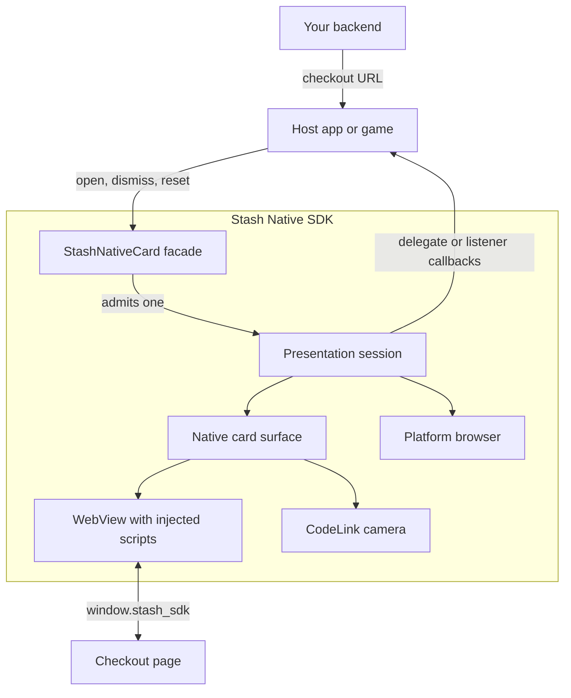
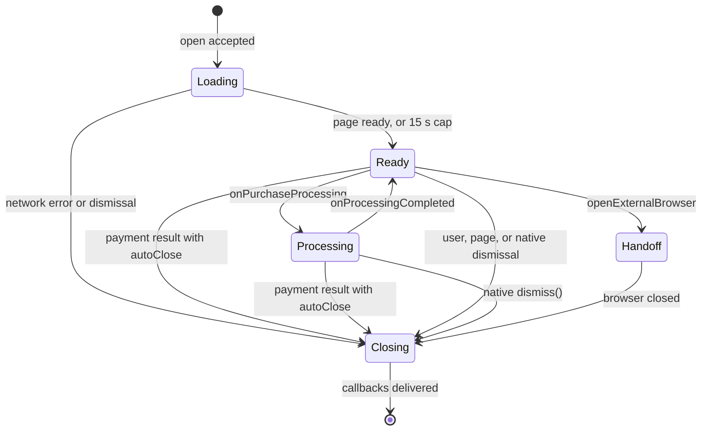
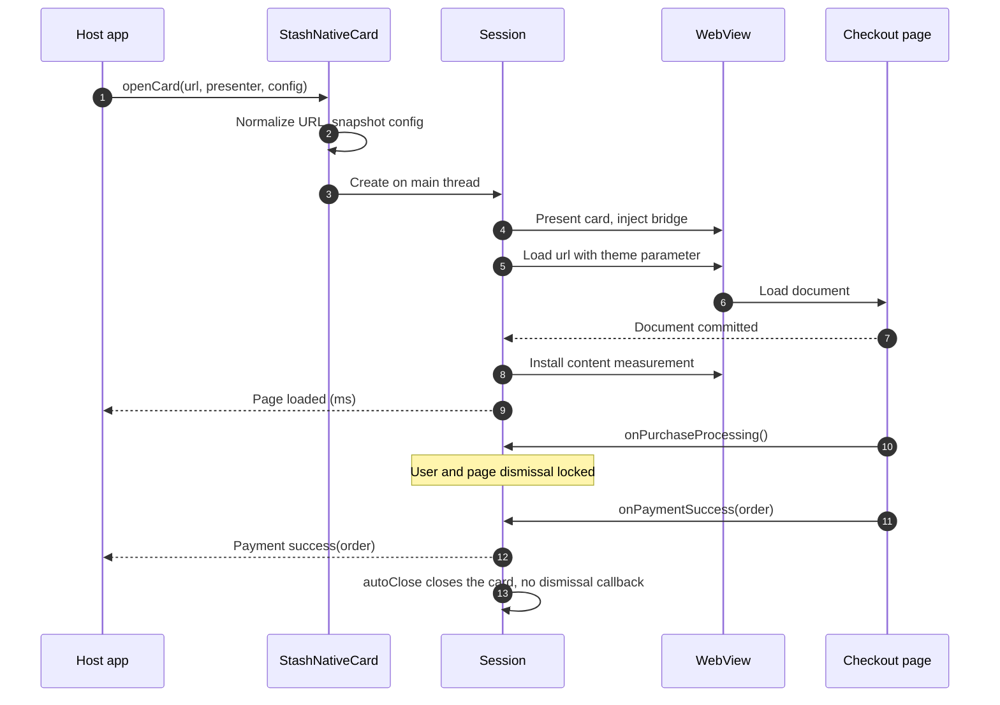
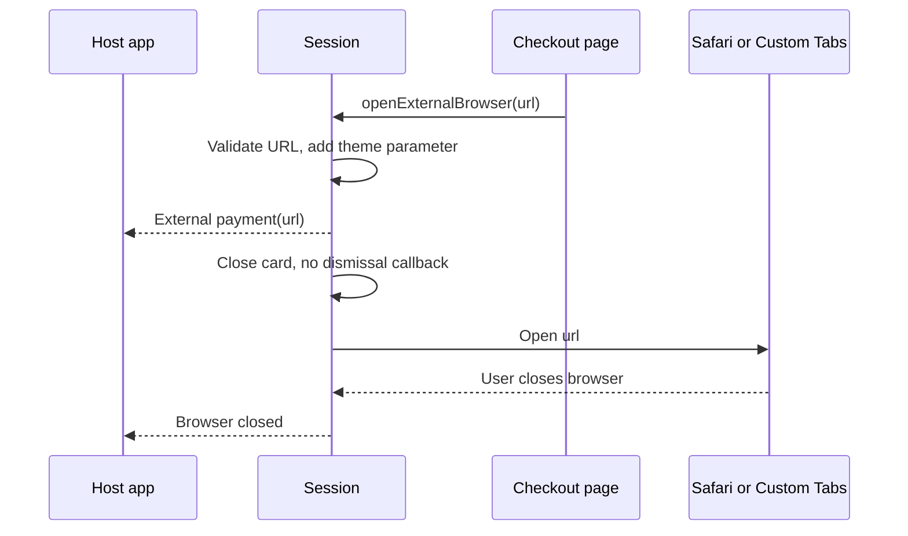
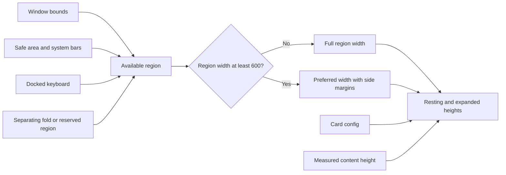
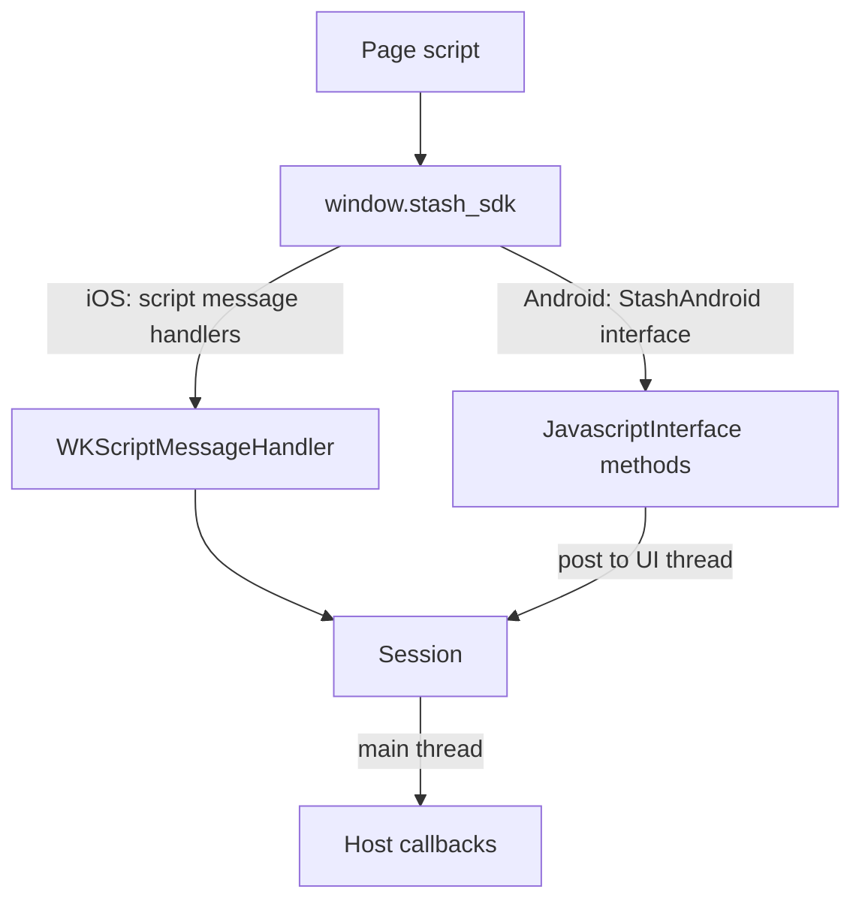

# Architecture

Both SDKs implement one contract. A singleton facade validates open requests and admits one presentation session at a time. The session hosts a WebView or camera in a native surface, translates `window.stash_sdk` messages into host callbacks, and tears everything down when the presentation ends.

Platform internals: [iOS](ios.md), [Android](android.md).

## Components

| Layer | iOS | Android | Responsibility |
|---|---|---|---|
| Facade | `StashNativeCard` | `StashNativeCard`, `StashNativeCardPlugin` | Public API, URL and config validation, single-session admission |
| Session | `StashCheckoutSession` | `StashNativeCardPlugin` session ID, `StashCheckoutActivity` | Callback ordering, once-guards, processing lock, load deadlines, teardown |
| Surface | `StashCheckoutViewController` in a `UISheetPresentationController` | `StashCheckoutActivity`, `StashPresentationController`, `StashSheetLayout` | Layout, gestures, keyboard, insets, folds |
| Web content | `WKWebView`, user scripts, script message handlers | `WebView`, `evaluateJavascript`, `StashAndroid` JavaScript interface | Bridge, navigation policy, content measurement, telemetry |
| Browser | `SFSafariViewController` | Custom Tabs through `StashNativeBrowserProxyActivity`, or `ACTION_VIEW` | Browser presentation and close detection |
| CodeLink | `StashCodeLinkViewController` (AVFoundation) | `StashCodeLinkSupport` (CameraX, ZXing) | QR scanning inside the card |

## Session lifecycle

A session starts when an open call is accepted and ends after its surface closes. Open calls made while a session exists are ignored without a callback. The exact end point differs by platform; see [Opening the next presentation](../usage/callbacks.md#opening-the-next-presentation).

`resetPresentationState()` ends a session from any state immediately and delivers no callbacks.

| State | Dismissal allowed | Notes |
|---|---|---|
| Loading | User (if `allowDismiss`), page, native | Native loading cover is visible. Load deadlines run on foreground time only. |
| Ready | User (if `allowDismiss`), page, native | Content revealed. Later navigations do not show the cover again. |
| Processing | Native `dismiss()` only | Grabber or handle hidden. A payment result or `onProcessingCompleted` clears the lock. |
| Handoff | Card already closed | The browser shows the external payment URL. On iOS, `dismiss()` closes Safari. |
| Closing | None | Dismissal animation and, for portrait cards, orientation restore. Then callbacks. |

Callback order for each terminal event is listed in [Callbacks and lifecycle](../usage/callbacks.md).

## Opening a checkout card

The SDK accepts `http` and `https` URLs only. A URL without a scheme gets `https://`. The SDK adds or replaces a `theme=light` or `theme=dark` query parameter based on the host's appearance before loading.

## External payment handoff

A checkout page can move payment into the platform browser with `openExternalBrowser(url)`.

The browser cannot report payment results. Return results through a deep link and confirm them on your backend.

## Presentation sizing

Card size comes from the current window, not from a device class or orientation. All dimensions are logical units: points on iOS, density-independent pixels on Android.

Both platforms resolve the card with the same rules. "Narrow" means a usable region less than 600 wide.

| Value | Rule |
|---|---|
| Margin | `min(edgeMargin, min(regionWidth, regionHeight) / 4)` |
| Width | Narrow: region width. Otherwise: `min(preferredContentWidth, regionWidth - 2 * margin)` |
| Height cap | Narrow: `regionHeight - margin`. Otherwise: `regionHeight - 2 * margin`. Also capped by `maximumContentHeight` when it is greater than 0. |
| Resting height | `min(preferredContentHeight, heightCap, measuredContentHeight)`. Measurement applies only when the page reports one. |
| Expanded height | Height cap |
| Placement | Android: bottom-attached when narrow, centered otherwise. iOS: UIKit attaches the sheet to the bottom edge in compact size classes and floats it when both size classes are regular. |

The card keeps a semantic selection, resting or expanded, separate from its physical height. Rotation, resizing, folding, and safe-area changes recompute both heights and keep the selection. An open keyboard expands the card temporarily; closing it restores the selection. When both heights resolve to the same value, the card has one physical stop but still remembers the selection.

The same WebView, document, form state, and scroll position survive every geometry change. Resizing never reloads checkout or emits another page-loaded callback.

iOS realizes these heights with native sheet detents. Android lays out its own card view. See [iOS presentation](ios.md#presentation) and [Android layout](android.md#layout).

## Bridge transport

The page API is the same on both platforms. The transport differs:

| | iOS | Android |
|---|---|---|
| Injection | `WKUserScript` at document start, main frame only | `evaluateJavascript` on page started, commit visible (API 29+), and page finished |
| Transport | `window.webkit.messageHandlers.<name>.postMessage` | `StashAndroid.<method>(...)` |
| Scope | `stash_sdk` exists in the main frame. Messages from other frames are ignored. | `stash_sdk` exists in the main frame. `StashAndroid` is visible to every frame, like any `addJavascriptInterface` object. |
| Stale messages | Dropped when the session is inactive | Dropped when the session ID no longer matches |

Handler names and the full method contract are in the [JavaScript bridge reference](../stash-sdk-js.md).

## Loading and recovery

| Stage | iOS | Android |
|---|---|---|
| Cover | Native loading cover until the page is ready | Loading view with spinner until the page is ready, then a 350 ms crossfade |
| Stall retry | One reload without cache after 10 s without a 2xx or 304 main-frame response | One reload with a `_stash_nc` cache-busting parameter after 10 s without a main-frame commit |
| Deadline | Network error after 15 s of foreground time without a response | Network error after 15 s of foreground time without a commit |
| HTTP error | Main-frame status 400 or higher before the first load: network error | Same, during the initial load |
| Readiness | Committed document with visible text or controls, or a finished load | Committed and finished document |
| Checkout origins | On `checkout.stash.gg` and `checkout.stashstaging.com`, also waits for the page theme marker to match the `theme` parameter and for skeleton placeholders to disappear | Same |
| Reveal cap | 15 s of foreground time | 15 s of foreground time |
| Renderer loss | Web content process terminated: reload once. A second loss, or a loss during processing: network error. | Renderer killed by the OS (API 26+): rebuild the WebView once. A crash, a second loss, or a loss during processing: network error. |
| Failure after load | Navigation failure closes the card with the dismissal callback | Host lookup, connect, timeout, or I/O failure on the main frame closes the card with the dismissal callback |

Time spent in the background does not count toward any deadline.

## Threading

- Open, dismiss, close, and reset methods can be called from any thread. Open calls capture the URL and config on the calling thread, then continue on the main thread.
- Set the delegate or listener on the main thread, before opening.
- Callbacks are delivered on the main thread.
- One card or CodeLink presentation exists at a time per process. On iOS, a Safari presentation also occupies the session. The facade is a singleton on both platforms.

## Ownership

| | iOS | Android |
|---|---|---|
| Callback target | `delegate`: weak under ARC, `assign` under manual reference counting | `setListener`: strong reference |
| Host reference | Presenting view controller held weakly | Host activity held weakly |
| Session state | `StashNativeCard.session` (strong) until teardown | Plugin fields plus the checkout activity, keyed by a session ID |
| Event path | Direct method calls on the main thread | Package-local broadcasts from the checkout activity to the plugin, posted to the main thread |
