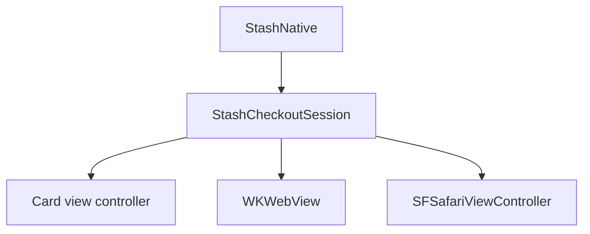

# iOS

An Objective-C library for iOS 15 and later that works with and without ARC. Source: [`iOS/StashNative/Sources/StashNative`](https://github.com/stashgg/stash-native/tree/main/iOS/StashNative/Sources/StashNative).

## Structure

The facade owns the active session. The session owns checkout state, the WebView, Safari, and callback delivery; view controllers handle layout. Events from a closed session are ignored.

| File | Responsibility |
|---|---|
| `include/StashNative.h` | Public API |
| `StashNative.m` | Facade and open checks |
| `StashNativeInternal.m` | Session, bridge messages, callbacks, loading timers |
| `StashNativeCard*.m` | Card layout, sheet detents, keyboard, gestures |
| `StashNativeOrientation.m` | Portrait checkout |
| `StashNativeViewUtils.m` | Injected scripts and URL checks |
| `StashNativeCodeLink.m` | QR scanner |

## Presentation

- Every card is a form sheet from one `UISheetPresentationController`, on iPhone, iPhone Duo, and iPad.
- Compact layouts switch between resting and expanded detents; iOS 15 uses the system medium and large detents. Regular layouts on iPad use one centered form sheet.
- The keyboard expands the card until it closes.

## Portrait checkout

On iPhone, portrait checkout runs in an SDK-owned window in the game's scene. The SDK rotates that window, presents the card in it, and restores the game's orientation before returning control and sending callbacks. On first use it adds an orientation method to the app delegate, and on iOS 27+ to the scene delegate. The game's own orientation settings stay unchanged. iPad ignores portrait.

## WebView

- Bridge calls arrive as WebKit script messages, from the top frame only.
- Handler names such as `stashNativementSuccess` are compatibility names; pages depend on them.
- Link previews, swipe navigation, pinch zoom, and bounce are off.

## Threading and memory

- Open calls copy their arguments and continue on the main thread.
- The delegate is `weak` under ARC and `assign` without ARC, so the game keeps it alive.
- Dismissal and network error callbacks run after teardown. Payment callbacks run before it.
