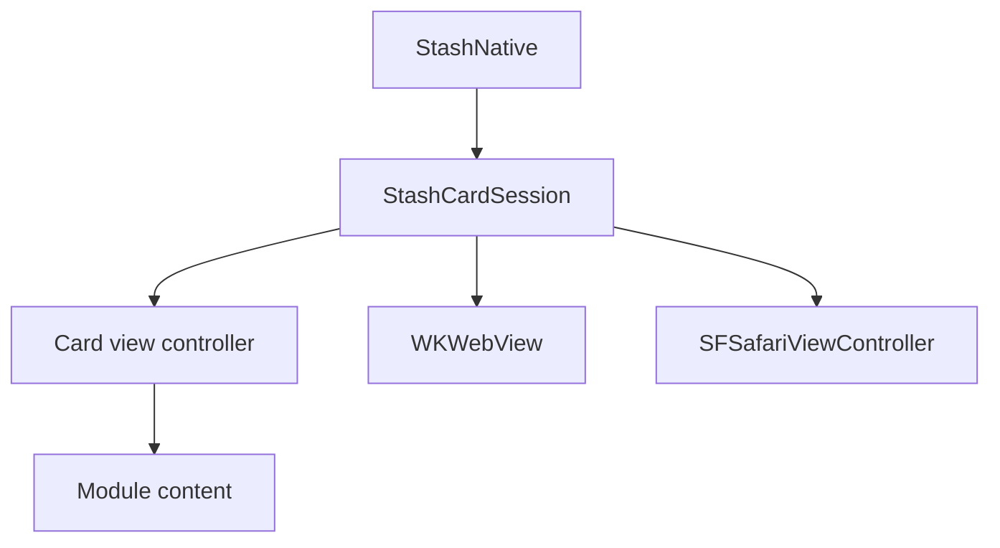

# iOS

An Objective-C library for iOS 15 and later that works with and without ARC. Source: [`iOS/StashNative/Sources`](https://github.com/stashgg/stash-native/tree/main/iOS/StashNative/Sources).

## Structure

The facade owns the active session. The session owns presentation state, the WebView, Safari, and event delivery; view controllers handle layout. Events from a closed session are ignored.

| File | Responsibility |
|---|---|
| `include/StashNative.h` | Public API |
| `StashNative.m` | Facade and open checks |
| `StashNativeInternal.m` | Session, bridge messages, events, loading timers |
| `StashNativeCard*.m` | Card layout, sheet detents, keyboard, gestures |
| `StashNativeOrientation.m` | Portrait presentation |
| `StashNativeViewUtils.m` | Injected scripts and URL checks |

## Presentation

- Every card is a form sheet from one `UISheetPresentationController`, on iPhone, iPhone Duo, and iPad.
- Compact layouts switch between resting and expanded detents; iOS 15 uses the system medium and large detents. Regular layouts on iPad use one centered form sheet.
- The keyboard expands the card until it closes.
- If the game dismisses the view controller that presented the card or Safari, the session ends with the matching dismissal event.

## Portrait presentation

- iPhone only. The card opens in an SDK-owned window in the game's scene.
- The SDK rotates that window and restores the game's orientation before returning control and sending events.
- On first use, the SDK adds an orientation method to the app delegate, and on iOS 27+ to the scene delegate. The game's orientation settings stay unchanged.

## Modules

- Each optional module is its own target and Swift package product.
- A module implements a content contract that the core finds at runtime, so the core never links the module's frameworks.

## WebView

- Bridge calls arrive as WebKit script messages, from the top frame only.
- Handler names such as `stashNativementSuccess` are compatibility names; pages depend on them.
- Link previews, swipe navigation, pinch zoom, and bounce are off.

## Threading and memory

- Open calls copy their arguments and continue on the main thread.
- `isCurrentlyPresented` and `isPurchaseProcessing` read main-thread state, so query them on the main thread.
- The delegate is `weak` under ARC and `assign` without ARC, so the game keeps it alive.
- Events that end a presentation run after teardown, so the game can open again from the callback. Payment events with `autoClose` off run while the card stays open.
