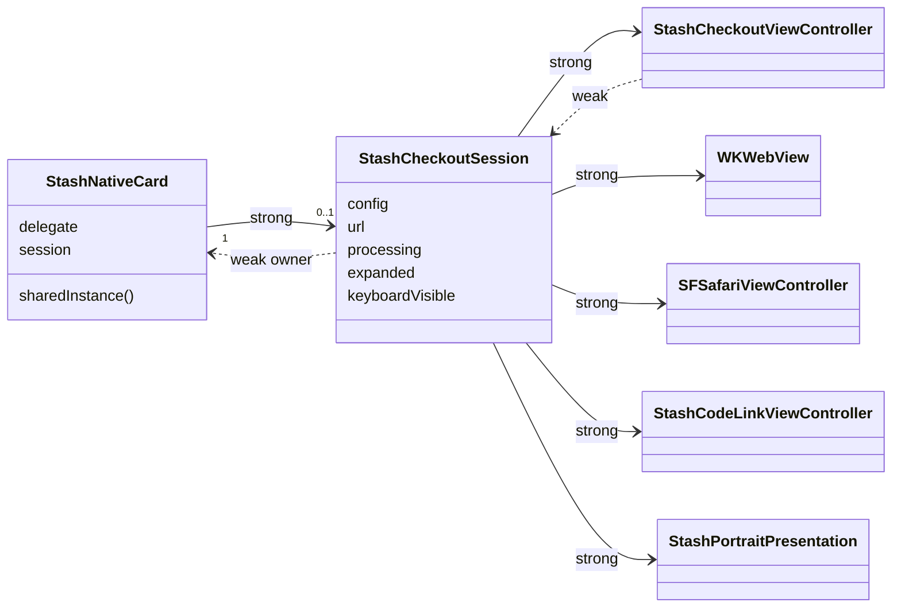
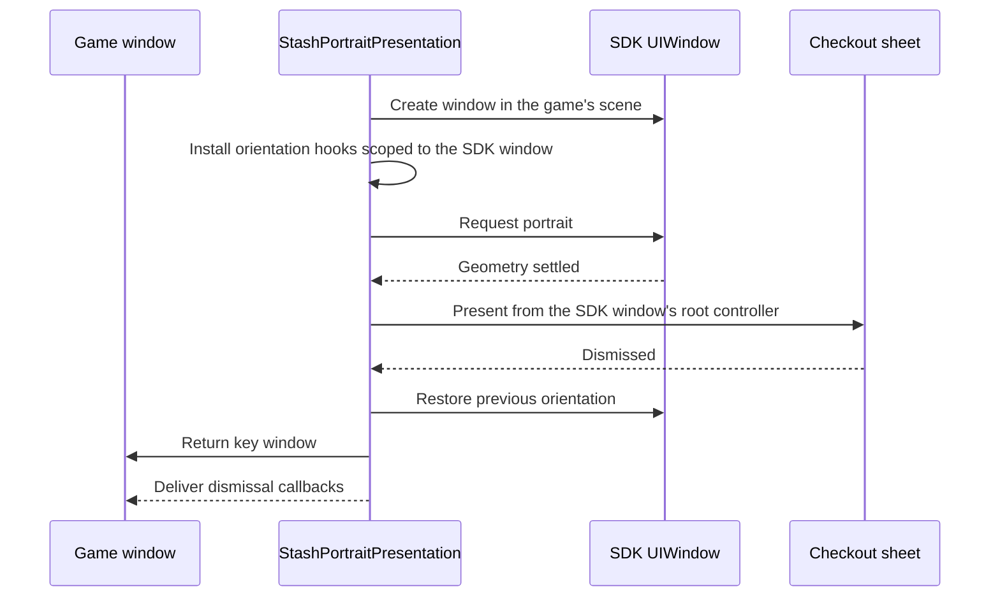

# iOS architecture

The iOS SDK is an Objective-C library in [`iOS/StashNative/Sources/StashNative`](https://github.com/stashgg/stash-native/tree/main/iOS/StashNative/Sources/StashNative). It compiles under ARC and manual reference counting (MRC) and supports iOS 15 and later.

## Source map

| File | Responsibility |
|---|---|
| `include/StashNativeCard.h` | Public API: facade, configs, delegate protocol, CodeLink error domain |
| `include/StashNative.h` | Umbrella header |
| `StashNativeCardPrivate.h` | Internal interfaces shared by all implementation files |
| `StashNativeCard.m` | Facade: singleton, open admission, main-thread dispatch, dismiss and reset |
| `StashNativeCardConfigs.m` | Config defaults, `NSCopying`, normalization |
| `StashNativeCardInternal.m` | `StashCheckoutSession`: WebView setup, bridge messages, callbacks, load budget, content reveal, browser handoff, teardown |
| `StashNativeCardWebViewDelegates.m` | Navigation policy, deep links, payment result URLs, process termination, JavaScript dialogs |
| `StashNativeCardViewUtils.m` | Injected scripts, URL normalization, input accessory removal |
| `StashNativeCardViewControllers.m` | `StashCheckoutViewController`: view lifecycle, layout, loading cover, accessibility escape |
| `StashNativeCardPresentation.m` | Sheet configuration, detents, available bounds |
| `StashNativeCardKeyboard.m` | Keyboard frames, docked/floating detection, focused field reveal |
| `StashNativeCardGestures.m` | Content-drag expansion, gesture arbitration, dismissal policy |
| `StashNativeCardGeometry.m` | Pure geometry: region selection, card sizing, measurement validation |
| `StashNativeCardOrientation.m` | Portrait window, orientation hooks, portrait Safari |
| `StashNativeCardTransitions.m` | Entrance animation correction on iOS 26+ |
| `StashNativeCardTheme.m` | Theme detection, sheet colors, `theme` query parameter |
| `StashNativeCardTelemetry.m` | `getTelemetry()` snapshot |
| `StashNativeCodeLink.m` | CodeLink scanner controller |

New implementation files must be added to `StashNative.xcodeproj` as well as the source tree. Swift Package Manager discovers files automatically; the Xcode project does not.

## Object graph

- `StashNativeCard.session` is the single active session. A session is active while `owner.session == self` and it is not closing.
- The session owns checkout state, callbacks, the WebView, the browser, and the presentation lifetime. View controllers own layout and UIKit presentation details.
- Teardown invalidates timers, removes script message handlers and KVO observers, clears WebView delegates, and restores orientation. Callbacks queued by an old session check `isActive` and become no-ops.
- `resetPresentationState` and `dealloc` call `retire`: the session detaches from its owner and dismisses without delegate callbacks.

## Presentation

Every card, including CodeLink, is a `UIModalPresentationFormSheet` driven by one `UISheetPresentationController`. UIKit owns the sheet surface, grabber, touch feedback, and transitions on iPhone, iPhone Duo, and iPad. The SDK configures the sheet:

| Setting | Value |
|---|---|
| `prefersGrabberVisible` | `YES`, hidden while purchase processing |
| `prefersEdgeAttachedInCompactHeight` | `YES` |
| `widthFollowsPreferredContentSizeWhenEdgeAttached` | `YES` |
| `prefersScrollingExpandsWhenScrolledToEdge` | `NO` on iOS 16+, `YES` on iOS 15 |
| `prefersPageSizing` | `NO` (iOS 17+) |
| `preferredPlacement` | Center (iOS 27+) |
| `preferredContentSize.width` | Resolved card width |

The sizing policy depends on the host's size classes:

| Host size classes | iOS | Detents | `expand()` and `collapse()` |
|---|---|---|---|
| Regular width and regular height | 15+ | One system `large` detent. Height comes from `preferredContentSize`. | Change the preferred content height |
| Any compact class | 16+ | Custom `stash-resting` and `stash-expanded` detents | Select a detent |
| Any compact class | 15 | System `medium` and `large`; `large` only in compact height | Select a detent |

When the resting and expanded heights are within 1 point, the compact sheet exposes one detent. The semantic selection is kept for the next geometry change. On iOS 15, configured heights are approximated by the system detents.

### Available bounds

`availableBoundsInView:` computes the region the card may use:

1. Start from the container's safe-area bounds. Bottom-attached cards ignore horizontal safe-area insets.
2. On iOS 27.1+, subtract active reserved regions of the occlusion and division kinds, such as the iPhone Duo fold.
3. Subtract a docked keyboard that covers more than 75% of the width and reaches the bottom edge. Floating and split keyboards do not shrink the card.
4. Choose the region that contains the presenter's center; otherwise the largest region. Ties prefer the lower region, then the trailing one in the current layout direction.

Resting compact cards stay below active status-bar occlusions. Dragging up, `expand()`, or keyboard entry can extend the sheet background behind the status region while the WebView stays in an unobstructed pane.

### Web surface

- The WebView fills the sheet below UIKit's grabber. No native header band is added.
- It paints through the bottom safe area. `contentInset` stays zero and `contentInsetAdjustmentBehavior` is `never`; only scroll indicators are inset. Pages own `env(safe-area-inset-bottom)` padding. See [page layout contract](../stash-sdk-js.md#page-layout-contract).
- The native background follows WebKit's `underPageBackgroundColor`. A probe script in the isolated `StashTopChrome` content world samples opaque page colors at the top edge and, when one surface covers the viewport, sets the WebView backing to match during resizing. Images and gradients are not reproduced; the fallback is the theme color (`#1E1E1E` dark, system background light).
- The loading cover stays until [readiness](index.md#loading-and-recovery). On iOS 26.1+, floating sheets show the system material while loading. Reduce Motion removes the reveal fade.
- On iOS 26+, `StashNativeEntranceCorrection` keeps compact iPhone card entrances centered. It finds UIKit's horizontal scale-compensation spring and adds an equal and opposite counter-animation on the same layer, so UIKit's spring and completion stay untouched. When the animation shape is not recognized, or Reduce Motion is on, nothing is added. Check rendered first frames on every new iOS release, because the match depends on an undocumented animation shape.

## Gestures and dismissal

| Input | Behavior |
|---|---|
| Upward drag on page content, resting compact card, iOS 16+ | Resizes the detent with the finger, then settles. Takes priority over page and nested scrolling. |
| Downward drag on page content | Never collapses or dismisses. The page scrolls. |
| Grabber | UIKit resizing and drag dismissal |
| VoiceOver escape | Dismisses when user dismissal is allowed |
| Keyboard, rotation, processing, `expand()`, `collapse()` | Cancels an active content drag |

Content-drag expansion is off for floating sheets, single-detent sheets, expanded cards, open keyboards, and purchase processing. User dismissal is blocked (`modalInPresentation`) when `allowDismiss` is `NO`, during purchase processing, after a successful CodeLink scan, and while a touch that began in web content is active.

## Keyboard

- An open keyboard selects the expanded height temporarily. Closing it restores the previous selection.
- Only a docked keyboard changes the available bounds. The WebView stays full height behind floating and split iPad keyboards.
- The interaction script scrolls the focused field above the keyboard, including fields inside iframes through a `postMessage` protocol, and repeats the repair after rotation.
- WebKit's previous/next/Done accessory bar is removed for the checkout's WebView responders only. The SDK creates a per-class runtime subclass of the WebKit content view; WebKit's shared implementation and the host's own text fields are untouched.
- When WebKit adds keyboard padding after the WebView already ends above a docked keyboard, the SDK normalizes the root scroll offset after interaction settles.

## Portrait presentation

`orientationPreference = .portrait` applies on iPhone only. iPad ignores it. CodeLink always follows the host.

- Orientation requests use `UIWindowScene.requestGeometryUpdate` on iOS 16+ and the `UIDevice` orientation fallback on iOS 15.
- On first portrait use, the SDK adds or replaces `application:supportedInterfaceOrientationsForWindow:` on the app delegate's class. The new implementation returns portrait for the SDK window and forwards every other window to the original implementation, or to the Info.plist orientations when the delegate had none. On iOS 27+, it hooks the scene delegate's `supportedInterfaceOrientationsForWindowScene:` the same way and adds portrait to the scene policy while the SDK window exists.
- The game view controller's orientation mask and autorotation methods are never changed.
- External payment presents Safari in the same portrait window. Orientation is restored when Safari closes.
- If the system refuses rotation, the card presents in the host's current geometry.
- While the SDK window is active, the scene reports portrait even though the game window keeps its landscape size. Engines that respond directly to scene geometry notifications need device testing.

## WebView configuration

| Item | Value |
|---|---|
| Script message handlers | `stashNativementSuccess`, `stashNativementFailure`, `stashPurchaseProcessing`, `stashProcessingCompleted`, `stashExpand`, `stashCollapse`, `stashTriggerHaptic`, `stashWindowClose`, `stashExternalPayment`, `stashOpenLink`, `stashContentHeight` |
| Reply handler | `stashTelemetry` in the page content world |
| User scripts at document start | Bridge (main frame), interaction script (all frames), top-edge color probe (main frame, isolated world) |
| Per-document scripts | Content measurement at `didCommitNavigation`, verified again at `didFinishNavigation` |
| Content mode | `WKContentModeMobile`, JavaScript enabled, `javaScriptCanOpenWindowsAutomatically = YES` |
| Disabled | Link previews, back/forward swipe, pinch zoom, scroll bounce |
| Inspection | `inspectable` follows `setInspectableWebViewsEnabled:` on iOS 16.4+ |
| Initial request | `NSURLRequestUseProtocolCachePolicy`, 60 s timeout |

The `stashNativement*` handler names are compatibility spellings. Keep them unchanged.

## Navigation policy

| Navigation | Result |
|---|---|
| Non-web scheme containing `stash-pay/success`, `stash-pay/failure`, or `stash-pay/cancel` | Payment success (no order), payment failure, or close request |
| Other non-web scheme | Cancelled in the WebView, passed to `UIApplication openURL:`. The card stays open. |
| Host `apps.apple.com` or `itunes.apple.com` | Passed to `openURL:` |
| User-tapped main-frame `http` or `https` link | Offered to `openURL:` with `UniversalLinksOnly`. Loads in the card when no app claims it. |
| New window (`target="_blank"`, `window.open`) | Non-web URLs get the `stash-pay` result handling first. Everything else goes to `openURL:`. `about:blank` and empty URLs are ignored. |
| `window.close()` or `webViewDidClose:` | Close request |
| `alert`, `confirm`, `prompt` | Native `UIAlertController` |

Web schemes are `http`, `https`, `about`, `blob`, `data`, `file`, and `javascript`.

## Threading and memory

- Public methods dispatch to the main queue when called elsewhere. `openCard` and `openBrowser` normalize the URL and copy the config before the dispatch.
- Delegate methods run on the main thread.
- `delegate` is `weak` under ARC and `assign` under MRC, selected with `__has_feature(objc_arc)` in the public header. The host or wrapper must keep the delegate alive.
- CI builds the library without ARC in addition to the normal ARC build. An ARC build alone does not verify MRC consumers.
- During a payment callback with `autoClose`, the session is still active, so an open call made inside that callback is ignored. Dismissal and network error callbacks run after the session is cleared, so the host can open the next presentation from them.
