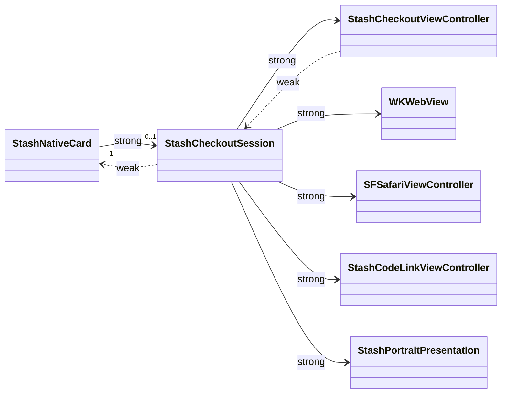
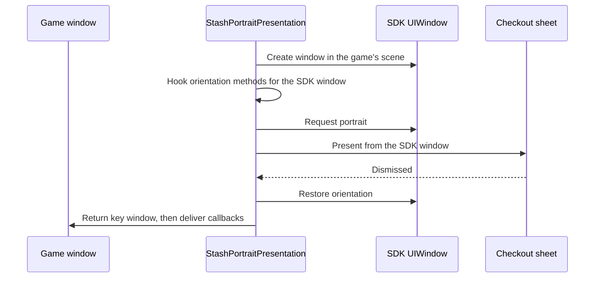

# iOS

An Objective-C library for iOS 15+, built with and without ARC. Source: [`iOS/StashNative/Sources/StashNative`](https://github.com/stashgg/stash-native/tree/main/iOS/StashNative/Sources/StashNative).

## Source map

| File | Responsibility |
|---|---|
| `include/StashNativeCard.h` | Public API |
| `StashNativeCardPrivate.h` | Internal interfaces |
| `StashNativeCard.m` | Facade, open validation, main-thread dispatch |
| `StashNativeCardConfigs.m` | Config defaults and normalization |
| `StashNativeCardInternal.m` | Session: WebView, bridge messages, callbacks, load deadlines, teardown |
| `StashNativeCardWebViewDelegates.m` | Navigation policy, deep links, process termination |
| `StashNativeCardViewUtils.m` | Injected scripts, URL validation |
| `StashNativeCardViewControllers.m` | Card controller lifecycle and layout |
| `StashNativeCardPresentation.m` | Sheet detents and available bounds |
| `StashNativeCardKeyboard.m` | Keyboard tracking and focused field reveal |
| `StashNativeCardGestures.m` | Content drag and dismissal policy |
| `StashNativeCardGeometry.m` | Sizing math |
| `StashNativeCardOrientation.m` | Portrait window and orientation hooks |
| `StashNativeCardTransitions.m` | Entrance animation correction (iOS 26+) |
| `StashNativeCardTheme.m` | Theme colors and `theme` parameter |
| `StashNativeCardTelemetry.m` | `getTelemetry()` |
| `StashNativeCodeLink.m` | QR scanner |

Add new files to `StashNative.xcodeproj` as well. Swift Package Manager finds them automatically; the Xcode project does not.

## Ownership

The session owns checkout state, callbacks, the WebView, and the browser. A session is active while the facade points to it and it is not closing. Teardown stops timers and removes message handlers, observers, and delegates. Late callbacks from an old session do nothing.

## Presentation

Every card is a form sheet driven by one `UISheetPresentationController`. UIKit owns the surface, grabber, and transitions on iPhone, iPhone Duo, and iPad.

| Host size classes | iOS | Detents | `expand()` and `collapse()` |
|---|---|---|---|
| Regular width and height | 15+ | One `large` detent; height from `preferredContentSize` | Change the preferred height |
| Compact | 16+ | Custom resting and expanded detents | Select a detent |
| Compact | 15 | System `medium` and `large` | Select a detent |

- Available bounds exclude the safe area, a docked keyboard, and, on iOS 27.1+, reserved regions such as the iPhone Duo fold.
- The WebView fills the sheet under the grabber and draws behind the home indicator. Pages pad the safe area.
- The native background follows the page background color.
- iOS 27+ requests centered sheet placement.

## Gestures and keyboard

- An upward drag on page content expands a resting compact card (iOS 16+). Downward drags never close it.
- The grabber resizes and dismisses the card through UIKit, and hides during processing.
- The keyboard expands the card until it closes. Only a docked keyboard shrinks the available area.
- WebKit's previous/next/Done bar is hidden for checkout fields only, through a per-class runtime subclass.

## Portrait

- iPhone only. CodeLink never uses it.
- iOS 16+ rotates with `requestGeometryUpdate`. iOS 15 sets the `UIDevice` orientation.
- On first use, the SDK adds or replaces `application:supportedInterfaceOrientationsForWindow:` on the app delegate class, and on iOS 27+ the scene delegate's orientation method. Other windows forward to the original implementation.
- The game's view controller orientation settings are never changed.
- External payment opens Safari in the same portrait window.

## WebView

| Item | Value |
|---|---|
| Message handlers | `stashNativementSuccess`, `stashNativementFailure`, `stashPurchaseProcessing`, `stashProcessingCompleted`, `stashExpand`, `stashCollapse`, `stashTriggerHaptic`, `stashWindowClose`, `stashExternalPayment`, `stashOpenLink`, `stashContentHeight`, and `stashTelemetry` (with reply) |
| Scripts at document start | Bridge (main frame), interaction (all frames), color probe (main frame, isolated world) |
| Per document | Content measurement |
| Disabled | Link previews, swipe navigation, pinch zoom, bounce |

Keep the `stashNativement*` handler names; wrappers and pages depend on them.

## Threading and memory

- Public methods dispatch to the main queue. Open calls copy the URL and config first.
- The delegate is `weak` under ARC and `assign` under manual reference counting. CI builds the library both ways.
- Dismissal and network error callbacks run after the session is cleared, so they can open the next presentation.
