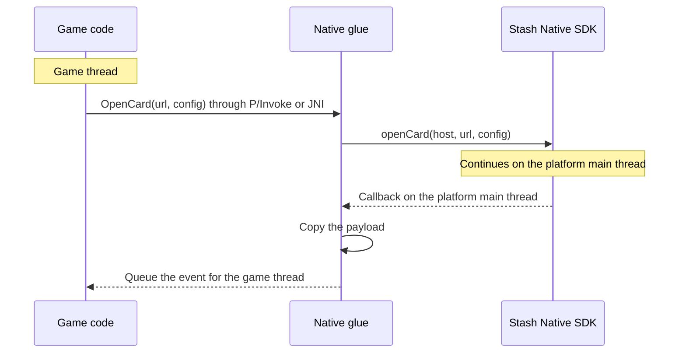

# Building wrappers

A wrapper exposes Stash Native to an engine's scripting layer. The official wrappers are [stash-unity](https://github.com/stashgg/stash-unity) and [stash-unreal](https://github.com/stashgg/stash-unreal); both still bind 2.x. Native 3.0 changes signatures and removes APIs, so it is not a drop-in binary replacement. Keep a wrapper release pinned to its tested native version until its bindings are migrated.

## Call and callback flow

A wrapper has three layers: the engine-facing API (C#, C++, Blueprints), native glue per platform (a Java class on Android, an Objective-C++ file on iOS), and the SDK binaries.



Keep the native glue thin. It converts types, supplies the host activity or view controller, keeps the callback receiver alive, and forwards callbacks to the engine's game thread. Presentation logic, ordering, and once-guards stay in the SDK.

## Binding surface

| Engine operation | Android | iOS |
|---|---|---|
| Open checkout card | `openCard(activity, url, CardConfig)` | `openCardWithURL:fromViewController:config:` |
| Open browser | `openBrowser(activity, url)` | `openBrowserWithURL:fromViewController:config:` |
| Open CodeLink | `codeLink(activity, CodeLinkConfig)` | `codeLinkFromViewController:config:` |
| Dismiss | `dismiss()` | `dismiss` |
| Close browser | No effect | `closeBrowser` |
| Reset | `resetPresentationState()` | `resetPresentationState` |
| Is presented | `isCurrentlyPresented()` | `isCurrentlyPresented` |
| Is processing | `isPurchaseProcessing()` | `isPurchaseProcessing` |
| WebView inspection | `StashNativeCard.setInspectableWebViewsEnabled(boolean)` | `+setInspectableWebViewsEnabled:` |
| SDK version | `StashNativeCard.getVersion()` | `+sdkVersion` |
| Portrait backdrop | `setBackdropBitmap(Bitmap)`, `setBackdropBytes(byte[])` | Not available |
| Keep-alive | `setKeepAliveEnabled(boolean)`, `setKeepAliveConfig(KeepAliveConfig)` | Not available |
| Close Safari with a result | Not available | `dismissSafariViewControllerWithResult:` |

Card config fields map one to one: `preferredContentWidth`, `preferredContentHeight`, `maximumContentHeight`, `edgeMargin`, `allowDismiss`, `autoClose`, `orientationPreference`. Units are points on iOS and dp on Android; do not convert them to pixels. Pass an engine-side "use default" as a `nil` or `null` config rather than copying default numbers into the wrapper, so SDK default changes reach games.

## Contract rules

1. **Supply the host on every open.** Pass the engine's current activity (Android) or the view controller attached to the game window (iOS). The SDK never looks up a foreground activity or scene. Do not cache a destroyed activity.
2. **Keep the receiver alive.** The iOS `delegate` is weak under ARC and `assign` without ARC; hold the delegate object in a static or a long-lived owner. Android holds the listener strongly. Register the receiver once, before the first open.
3. **Marshal callbacks to the game thread.** SDK callbacks run on the platform main thread, which is not the Unity or Unreal game thread. Copy payloads, then enqueue them.
4. **Preserve order and payloads.** Forward every callback in the order received. Keep `null` distinct from an empty string where the engine type allows it. Do not merge, drop, or reorder events.
5. **Do not infer outcomes.** Engine pause, resume, and focus events are not payment success or cancellation. Use the SDK callbacks only, and confirm purchases on the game backend.
6. **One presentation at a time.** Open calls during an active session are ignored without a callback. To report "busy" to game code, check `isCurrentlyPresented` before calling. Never dismiss and reopen to handle rotation, resizing, or folding; the SDK updates the open card in place.
7. **No processing callback exists.** Query `isPurchaseProcessing` when the game needs it. Do not use reflection into SDK internals; private fields and classes change between releases.
8. **Leave the page contract alone.** Do not inject or redefine `window.stash_sdk` in production checkout.
9. **Remove engine-side orientation code.** The SDK owns portrait presentation and restoration on iPhone and Android. Wrapper-owned orientation unlocks, app delegate hooks, rotation nudges, and iOS screenshot backdrops from 2.x must go.

## Android glue

A Java class compiled into the wrapper's Android library implements the listener and forwards events to native code or to the engine's messaging API.

```java
package com.example.stash;

import android.app.Activity;
import com.stash.stashnative.StashNativeCard;

public final class StashBridge implements StashNativeCard.StashNativeCardListener {
    private static final StashBridge INSTANCE = new StashBridge();

    // Implemented in the engine's native code; queues the event for the game thread.
    private static native void nativeOnEvent(String name, String payload);

    public static void initialize() {
        StashNativeCard.getInstance().setListener(INSTANCE);
    }

    public static void openCard(Activity activity, String url, float width, float height,
            float maximumHeight, float margin, boolean allowDismiss, boolean autoClose,
            boolean portrait) {
        StashNativeCard.CardConfig config = new StashNativeCard.CardConfig();
        config.preferredContentWidth = width;
        config.preferredContentHeight = height;
        config.maximumContentHeight = maximumHeight;
        config.edgeMargin = margin;
        config.allowDismiss = allowDismiss;
        config.autoClose = autoClose;
        config.orientationPreference = portrait
                ? StashNativeCard.CardConfig.ORIENTATION_PORTRAIT
                : StashNativeCard.CardConfig.ORIENTATION_FOLLOW_HOST;
        StashNativeCard.getInstance().openCard(activity, url, config);
    }

    @Override public void onPaymentSuccess(String order) { nativeOnEvent("paymentSuccess", order); }
    @Override public void onPaymentFailure() { nativeOnEvent("paymentFailure", null); }
    @Override public void onDialogDismissed() { nativeOnEvent("dismissed", null); }
    @Override public void onPageLoaded(long ms) { nativeOnEvent("pageLoaded", Long.toString(ms)); }
    @Override public void onNetworkError() { nativeOnEvent("networkError", null); }
    @Override public void onExternalPayment(String url) { nativeOnEvent("externalPayment", url); }
    @Override public void onBrowserClosed() { nativeOnEvent("browserClosed", null); }
    @Override public void onQrCodeScanned(String content) { nativeOnEvent("qrScanned", content); }
    @Override public void onCodeLinkError(StashNativeCard.CodeLinkError error) {
        nativeOnEvent("codeLinkError", error.name());
    }
}
```

Notes:

- Implement every listener method, including the default `onQrCodeScanned` and `onCodeLinkError`. Some engines implement listeners with dynamic proxies; prefer a concrete Java class.
- `openCard`, `codeLink`, and `openBrowser` can be called from the engine thread. The SDK posts to the main thread.
- `@JavascriptInterface` and listener code never run on the engine thread. Queue work for the engine.
- If native code reads payloads with JNI `GetStringUTFChars`, it receives Modified UTF-8, which encodes characters outside the Basic Multilingual Plane differently from standard UTF-8. Order payloads are page-supplied JSON and can contain such characters. Read strings with `GetStringChars` (UTF-16), or pass `String.getBytes(StandardCharsets.UTF_8)` instead.

| Engine | Host activity | Callback delivery |
|---|---|---|
| Unity | `new AndroidJavaClass("com.unity3d.player.UnityPlayer").GetStatic<AndroidJavaObject>("currentActivity")` in C#, or `UnityPlayer.currentActivity` in Java | `UnityPlayer.UnitySendMessage(gameObject, method, payload)` runs the C# method on Unity's main thread in a later frame |
| Unreal Engine | `FJavaWrapper::GameActivityThis` from C++, or the `GameActivity` instance inside UPL Java additions | A `JNIEXPORT` native method that copies the payload into an `FString` and calls `AsyncTask(ENamedThreads::GameThread, ...)` |

### Android packaging

Ship the AAR and declare its dependencies in the engine's Gradle integration. A file-based AAR adds none of them automatically.

| Engine | Where to declare dependencies |
|---|---|
| Unity | An External Dependency Manager `Dependencies.xml`, or the custom main Gradle template |
| Unreal Engine | UPL `<buildGradleAdditions>` with `implementation` lines; copy the AAR with `<gradleCopies>` |

Unity `Editor/StashDependencies.xml` for External Dependency Manager:

```xml
<dependencies>
  <androidPackages>
    <androidPackage spec="androidx.core:core:1.12.0" />
    <androidPackage spec="androidx.webkit:webkit:1.11.0" />
    <androidPackage spec="androidx.window:window:1.4.0" />
    <androidPackage spec="androidx.window:window-java:1.4.0" />
    <androidPackage spec="androidx.browser:browser:1.7.0" />
  </androidPackages>
</dependencies>
```

- Add CameraX and ZXing only when the wrapper exposes CodeLink. Without them, CodeLink reports `CAMERA_CONFIGURATION_FAILED`.
- Keep WindowManager at 1.4.x while the game supports API 21.
- The AAR's consumer R8 rules cover the SDK. Wrappers that avoid reflection into the SDK need no `-keep class com.stash.**` rule. Keep rules for the wrapper's own JNI entry points are still required.
- Do not force the game's compile SDK, target SDK, or minification settings from the wrapper.
- Do not add `android:process` to the SDK activities.
- Inspect the game's resolved dependency graph and build a minified release; engines often pin older AndroidX versions.

## iOS glue

An Objective-C++ file compiled into the game exports C functions for the engine and owns the delegate.

```objc
#import <StashNative/StashNative.h>

// Payload is NULL when the event has none. The callee copies it and queues it for the game thread.
typedef void (*StashEventCallback)(const char *name, const char *payload);
static StashEventCallback gCallback;

// Supplied per engine; see the presenter table below.
extern UIViewController *StashEnginePresenter(void);

@interface StashBridgeDelegate : NSObject <StashNativeCardDelegate>
@end

@implementation StashBridgeDelegate
static void Emit(const char *name, NSString *payload) {
    if (gCallback) gCallback(name, payload.UTF8String);
}
- (void)stashNativeCardDidCompletePaymentWithOrder:(NSString *)order { Emit("paymentSuccess", order); }
- (void)stashNativeCardDidFailPayment { Emit("paymentFailure", nil); }
- (void)stashNativeCardDidDismiss { Emit("dismissed", nil); }
- (void)stashNativeCardDidLoadPage:(double)ms { Emit("pageLoaded", [NSString stringWithFormat:@"%.0f", ms]); }
- (void)stashNativeCardDidEncounterNetworkError { Emit("networkError", nil); }
- (void)stashNativeCardDidRequestExternalPaymentWithURL:(NSString *)url { Emit("externalPayment", url); }
- (void)stashNativeCardDidCloseBrowser { Emit("browserClosed", nil); }
- (void)stashNativeCardDidScanQRCode:(NSString *)content { Emit("qrScanned", content); }
- (void)stashNativeCardCodeLinkDidEncounterError:(NSError *)error {
    Emit("codeLinkError", [NSString stringWithFormat:@"%ld", (long)error.code]);
}
@end

static StashBridgeDelegate *gDelegate;  // Strong owner; the SDK holds the delegate weakly.

extern "C" void StashBridgeInitialize(StashEventCallback callback) {
    gCallback = callback;
    dispatch_async(dispatch_get_main_queue(), ^{
        if (!gDelegate) gDelegate = [[StashBridgeDelegate alloc] init];
        [StashNativeCard sharedInstance].delegate = gDelegate;
    });
}

extern "C" void StashBridgeOpenCard(const char *url, bool portrait) {
    NSString *checkoutURL = url ? [NSString stringWithUTF8String:url] : nil;
    dispatch_async(dispatch_get_main_queue(), ^{
        UIViewController *presenter = StashEnginePresenter();
        StashNativeCardConfig *config = [[StashNativeCardConfig alloc] init];
        config.orientationPreference = portrait ? StashNativeOrientationPreferencePortrait
                                                : StashNativeOrientationPreferenceFollowHost;
        [[StashNativeCard sharedInstance] openCardWithURL:checkoutURL
                                       fromViewController:presenter
                                                   config:config];
    });
}
```

Notes:

- The example uses ARC. Without ARC, retain `gDelegate` and release the config and any copied strings yourself. The SDK supports both modes; test the mode your engine compiles with. Unreal Engine compiles Objective-C without ARC unless the module sets `bEnableObjCAutomaticReferenceCounting = true`.
- `UTF8String` buffers are autoreleased. The engine callback must copy the bytes before it returns.
- Create the C string from the URL on the calling thread, as above. The engine may free its buffer as soon as the call returns.
- Engine C# or C++ callbacks registered as function pointers must be static, and on IL2CPP marked `[MonoPInvokeCallback]`.

| Engine | Presenter | Callback delivery |
|---|---|---|
| Unity | `UnityGetGLViewController()` | `UnitySendMessage(gameObject, method, payload)`, or a `[MonoPInvokeCallback]` function pointer that queues for the main thread |
| Unreal Engine | `[IOSAppDelegate GetDelegate].IOSController`, the engine's root view controller | Copy into an `FString`, then `AsyncTask(ENamedThreads::GameThread, ...)` |

### iOS packaging

| Engine | Framework |
|---|---|
| Unity | Place `StashNative.xcframework` under `Plugins/iOS` and mark it to be embedded in the generated Xcode project |
| Unreal Engine | `PublicAdditionalFrameworks.Add(new Framework("StashNative", path, null, true))` in `Build.cs`; the last argument copies the framework into the app bundle |
| Native Xcode project | Swift Package Manager, or the XCFramework with Embed & Sign |

- `StashNative.framework` is a dynamic framework. It must be embedded and signed, or the app fails to launch.
- Add `NSCameraUsageDescription` when the wrapper exposes CodeLink.
- Build the game with Xcode 27.1 and the iOS 27.1 SDK for iPhone Duo layout. The framework alone cannot opt an older game build in.
- The SDK hooks the app delegate's orientation method on first portrait use and forwards other windows to the original. Engine app delegates that implement `application:supportedInterfaceOrientationsForWindow:` keep working. Do not install a competing hook.

## Callback mapping

| SDK event | Suggested engine event | Payload |
|---|---|---|
| Payment success | `OnPaymentSuccess(string order)` | Order string, or null |
| Payment failure | `OnPaymentFailure()` | None |
| Dismissed | `OnDismissed()` | None |
| Page loaded | `OnPageLoaded(double milliseconds)` | Duration. Semantics differ by platform, see below. |
| Network error | `OnNetworkError()` | None |
| External payment | `OnExternalPayment(string url)` | URL |
| Browser closed | `OnBrowserClosed()` | None |
| QR code scanned | `OnCodeLinkScanned(string content)` | Raw payload |
| CodeLink error | `OnCodeLinkError(CodeLinkError error)` | Map iOS codes 1 to 4 and the Android enum to one engine enum |

Suggested unified CodeLink error enum:

| Engine value | iOS code | Android |
|---|---|---|
| `PermissionDenied` | 1 `CameraPermissionDenied` | `CAMERA_PERMISSION_DENIED` |
| `CameraUnavailable` | 2 `CameraUnavailable` | `CAMERA_UNAVAILABLE` |
| `ConfigurationFailed` | 3 `CameraConfigurationFailed` | `CAMERA_CONFIGURATION_FAILED` |
| `PermissionNotDeclared` | 4 `MissingCameraUsageDescription` | `CAMERA_PERMISSION_NOT_DECLARED` |

Delivery order for each outcome is in [Callbacks and lifecycle](usage/callbacks.md#delivery-order).

## Platform differences

Wrappers that present one API across platforms must account for these:

| Behavior | iOS | Android |
|---|---|---|
| `isCurrentlyPresented` during `openBrowser` | `true` | `false` |
| `isCurrentlyPresented` during an external payment browser | `true` until Safari closes | `false` from the handoff |
| `openBrowser` while a card is open | Ignored | Opens the browser |
| Opening from a payment callback with `autoClose` | Ignored; the card is still closing | Accepted |
| `closeBrowser` | Closes Safari: dismissed, then browser closed | No effect |
| Page loaded duration | Presentation start to first finished navigation | Last navigation start to end of the loading crossfade |
| Network error callback | After the card has closed | While the activity finishes |
| Legacy no-argument payment success | Called when `withOrder` is not implemented | None |
| Callback receiver | Weak (`assign` without ARC) | Strong |
| New-window `stash-pay` deep link | Treated as a payment result | Passed to the OS |
| CodeLink without camera libraries | Not applicable | `CAMERA_CONFIGURATION_FAILED`, card closes |
| Portrait backdrop, keep-alive | Not available | Available |
| Browser orientation preference, closing Safari with a result | Available | Not available |

## Migrating a 2.x binding

| 2.x binding | 3.0 binding |
|---|---|
| Android `setActivity(activity)` once | Pass the activity to `openCard`, `openBrowser`, and `codeLink` |
| iOS `openCardWithURL:config:` | `openCardWithURL:fromViewController:config:` |
| iOS `openBrowserWithURL:` | `openBrowserWithURL:fromViewController:` |
| `openModal`, `ModalConfig`, `StashNativeModalConfig` | `openCard` or `openBrowser` |
| `openPopup`, popup size configs | Removed |
| Ratio fields (`cardHeightRatioPortrait`, `tabletWidthRatioLandscape`, ...) | `preferredContentWidth`, `preferredContentHeight`, `maximumContentHeight`, `edgeMargin` |
| `forcePortrait` | `orientationPreference` |
| `backgroundColor` | Removed; background matching is automatic |
| `onOptInResponse`, `stashNativeCardDidReceiveOptIn:` | Removed |
| iOS `disableAutoOrientationUnlock`, `+supportedInterfaceOrientationsForWindow:` | Removed; the SDK scopes its own orientation hooks |
| Reflection into SDK private fields for processing state | `isPurchaseProcessing` |
| Not bound | `codeLink`, `onQrCodeScanned`, `onCodeLinkError` |

Full list: [Migrating to 3.0](migration-3.0.md).

## Validation

Run these on devices, from the engine's real render hierarchy:

- Open from the game's actual activity or root view controller, with the game in landscape and in portrait.
- Purchase processing locks, payment success and failure with `autoClose` on and off, and exactly-once terminal callbacks.
- External payment, browser return, and deep link return.
- Rotate, resize, and fold with the same checkout open, including while a payment field has keyboard focus. The form, scroll position, and page-load count must not change.
- Repeated opens, opening from the dismissal callback, `resetPresentationState()` during loading, and engine scene changes.
- Background and foreground the game during loading and during payment.
- A minified Android release build with the dependency set you ship, and an iOS build in the engine's ARC or non-ARC mode.
- CodeLink permission denial, grant from Settings, and a successful scan, if exposed.

Editor simulations are useful for game logic. They do not exercise `WKWebView`, Android WebView, payment provider redirects, or device orientation policy.
