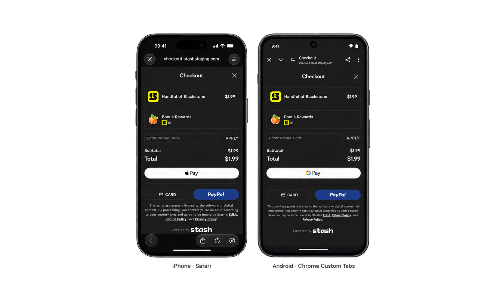
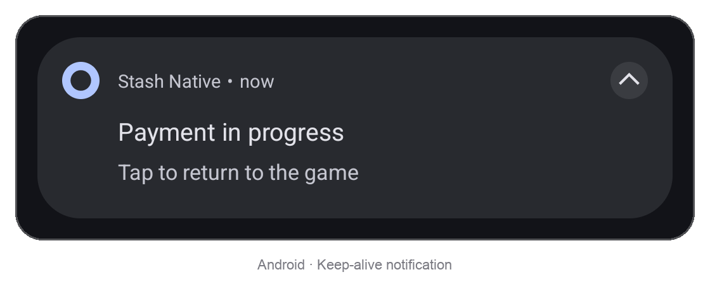

# In-Game Browser

The in-game browser opens [checkout](https://docs.stash.gg/guides/stash-pay/integration#create-a-checkout-link) or [webshop](https://docs.stash.gg/guides/stash-webshop/about) links in Safari View Controller (iOS) or Chrome Custom Tabs (Android) without leaving the game.



## What this means?

On iOS, `SFSafariViewController` presents a Safari view within your app; on Android, Chrome Custom Tabs (CCT) present a view over your app using a compatible installed browser. Users stay in the app's flow without switching to a full browser and can close the view to return quickly to the host application. This makes the in-game browser an alternative to the [Checkout Card](checkout-card.md) for Stash Pay or a quick entry point to Stash Webshop.

## Open the browser

```swift
StashNative.sharedInstance().openBrowser(withURL: url, from: self)
```

```java
StashNative.getInstance().openBrowser(activity, url);
```

On Android, Custom Tabs require `androidx.browser` ([Package Installation](../index.md#android)). Without it, links open in the system browser.

## Forcing Portrait Browser (iOS)

Use this flag to open the browser in portrait on iPhone, even when the host application is locked to landscape. This is currently supported only on iOS. Android does not support forcing Chrome Custom Tabs into portrait, so users must rotate their device manually.

```swift
let config = StashNativeBrowserConfig()
config.orientationPreference = .portrait
StashNative.sharedInstance().openBrowser(withURL: url, from: self, config: config)
```

## Keep-alive service (Android)

{: .close-up }

Android may suspend or stop the host app while the browser is open, especially on low-memory devices or in power-saving mode; behavior varies by vendor. The keep-alive service helps prevent this with a foreground notification. It is off by default but we recommend enabling it.

Configure and enable it once in your app's code; the SDK starts the service automatically each time it opens the browser.

```java
StashNative.KeepAliveConfig config = new StashNative.KeepAliveConfig();
config.notificationTitle = "Payment in progress";
config.notificationText = "Tap to return to the game";
config.notificationIconResId = R.drawable.ic_notification; // 0 uses the app icon
StashNative.getInstance().setKeepAliveConfig(config);
StashNative.getInstance().setKeepAliveEnabled(true);
```

On Android 13+, add and request `POST_NOTIFICATIONS` if you haven't already. Without it, the service runs without a visible notification.

```xml
<uses-permission android:name="android.permission.POST_NOTIFICATIONS" />
```
{: .platform-android }

## Handling Results

{: .warning }
Unlike the Checkout Card, the in-game browser sends no direct callbacks because the browser is isolated from the game. Stash Pay checkout or webshop reports purchase results to the game through a deep link instead.

Set your URL scheme in [Stash Studio](https://docs.stash.gg/guides/get-started/stash-studio/getting-started) under **Project Settings > General > App Deeplink Protocol**, without `://`, for example `mygame`.

| Deep link | Sent when |
|---|---|
| `mygame://stash-pay/success` | The purchase completed |
| `mygame://stash-pay/failure` | The purchase failed |

The SDK does not handle deep links. Configure them in your host app as described by [Apple](https://developer.apple.com/documentation/xcode/defining-a-custom-url-scheme-for-your-app) and [Android](https://developer.android.com/training/app-links/create-deeplinks).

On iOS, close Safari when the deep link arrives. `dismissSafariViewController(withResult:)` closes it and sends the payment [callback](#callbacks):

```swift
StashNative.sharedInstance().dismissSafariViewController(withResult: true)  // mygame://stash-pay/success
StashNative.sharedInstance().dismissSafariViewController(withResult: false) // mygame://stash-pay/failure
```

## Callbacks

These events go to the shared receiver; see [Setting Callbacks](callbacks.md).

| Callback (iOS / Android) | Fires when |
|---|---|
| `stashNativeDidDismissBrowser()`<br>`onBrowserDismissed()` | The browser closes, after `openBrowser` or an external payment that closed the card |

## Other

### Checking state

For standalone browsers, `isCurrentlyPresented` is `true` on iOS and `false` on Android. It stays `true` on both platforms when a card remains open beneath the browser. On iOS, read it on the main thread.

```swift
let isPresented = StashNative.sharedInstance().isCurrentlyPresented
```

```java
boolean isPresented = StashNative.getInstance().isCurrentlyPresented();
```

### Closing the browser

`closeBrowser()` closes Safari on iOS. On Android, it only closes a browser opened by checkout over an active card; standalone Custom Tabs cannot be closed programmatically.

```swift
StashNative.sharedInstance().closeBrowser()
```

```java
StashNative.getInstance().closeBrowser();
```
