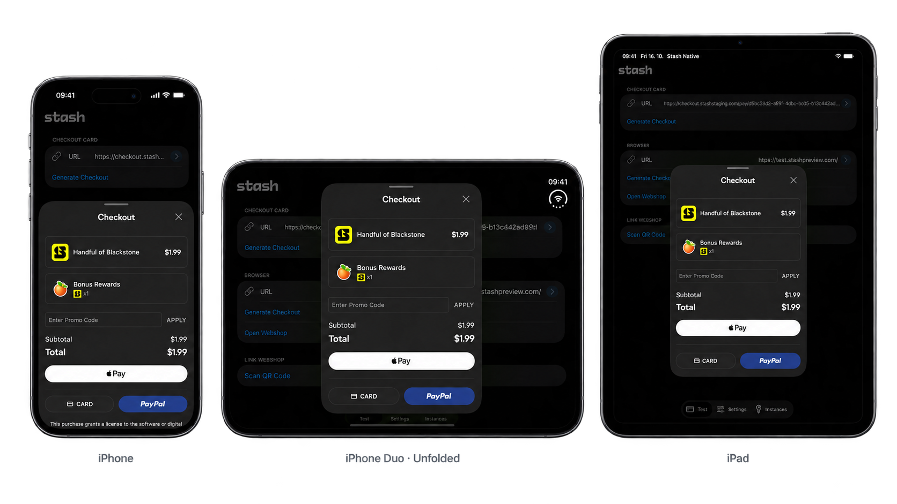
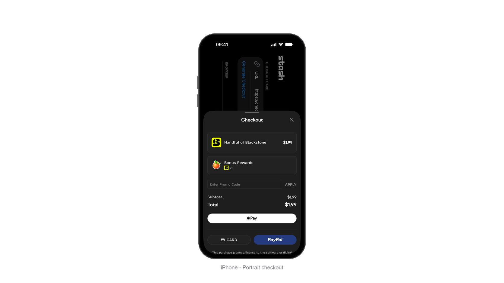
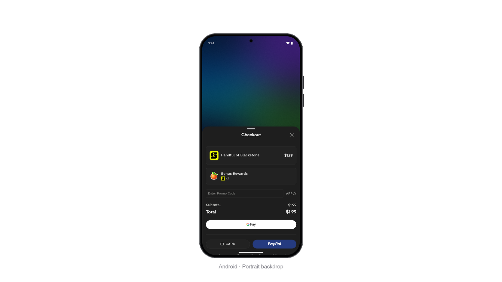

# Checkout Card

The checkout card shows Stash Pay checkout in a native card over the game. Results arrive through [callbacks](#callbacks).



The card fits phones, tablets, foldables, and split screen, and follows light or dark mode.

## Open the card

Pass the [checkout link](https://docs.stash.gg/guides/stash-pay/integration#create-a-checkout-link) from your backend and the view controller or activity showing the game:

```swift
StashNative.sharedInstance().openCard(withURL: checkoutURL, from: self, config: nil)
```

```java
StashNative.getInstance().openCard(activity, checkoutUrl, null);
```

`dismiss()` closes the card, even during a payment. Check `isPurchaseProcessing` first. `isCurrentlyPresented` reports whether a card, scanner, or Safari (iOS) is open.

## Configuration

Pass `StashNativeCardConfig` (iOS) or `StashNative.CardConfig` (Android), or `nil`/`null` for the defaults. Sizes are in points (iOS) or dp (Android). The card never exceeds the screen.

| Property | Default | Description |
|---|---|---|
| `preferredContentWidth` | `400` | Card width on tablets and on phones in landscape, within the safe area and edge margins. Portrait phones use the full width. |
| `preferredContentHeight` | `560` | Height when the card opens. Short pages open shorter. |
| `maximumContentHeight` | `720` | Height when expanded, for example for the keyboard. `0` removes the limit. |
| `edgeMargin` | `16` | Space between the card and the screen edges |
| `allowDismiss` | `true` | Players can close the card by swiping down, tapping outside, or pressing Back |
| `autoClose` | `true` | The card closes after a payment succeeds or fails |
| `orientationPreference` | Follow host | Portrait on phones. See [Forcing portrait checkout](#forcing-portrait-checkout). |

```swift
let config = StashNativeCardConfig()
config.allowDismiss = false
StashNative.sharedInstance().openCard(withURL: checkoutURL, from: self, config: config)
```

```java
StashNative.CardConfig config = new StashNative.CardConfig();
config.allowDismiss = false;
StashNative.getInstance().openCard(activity, checkoutUrl, config);
```

## Forcing portrait checkout

{: .single-device }

On phones, the card can open in portrait in a landscape game, including a landscape-only one. The game's orientation returns when the card closes.

```swift
config.orientationPreference = .portrait
```

```java
config.orientationPreference = StashNative.CardConfig.ORIENTATION_PORTRAIT;
```

Tablets, unfolded foldables, and split screen keep the game's orientation.

## Portrait backdrop (Android)

{: .single-device }

On Android, the game rotates behind a portrait card, which can cause glitches. To hide them, pass a screenshot of the game before opening the card:

```java
StashNative.setBackdropBitmap(screenshot); // or setBackdropBytes(pngOrJpegBytes)
StashNative.getInstance().openCard(activity, checkoutUrl, config);
```

The SDK takes ownership of the bitmap; do not reuse or recycle it. iOS needs no backdrop.

## WebView debugging

During development, make checkout inspectable before opening the card:

```swift
StashNative.setInspectableWebViewsEnabled(true)
```

```java
StashNative.setInspectableWebViewsEnabled(true);
```

Inspect it with Safari Web Inspector (iOS 16.4+) or `chrome://inspect` (Android). Keep it off in release builds.

## Callbacks

These events go to the shared receiver; see [Setting Callbacks](callbacks.md).

| Callback (iOS / Android) | Fires when |
|---|---|
| `stashNativeDidCompletePayment(withOrder:)`<br>`onPaymentSuccess(order)` | The player completes a payment |
| `stashNativeDidFailPayment()`<br>`onPaymentFailure()` | The payment fails |
| `stashNativeDidDismissCard()`<br>`onCardDismissed()` | The player or checkout closes the card, or you call `dismiss()` |
| `stashNativeDidLoadPage(_:)`<br>`onPageLoaded(loadTimeMs)` | Checkout finished loading. Reports the load time in milliseconds. |
| `stashNativeDidEncounterNetworkError()`<br>`onNetworkError()` | Checkout failed to load or lost its connection. The card closes. |
| `stashNativeDidRequestExternalPayment(with:)`<br>`onExternalPayment(url)` | Checkout moves the payment to the in-game browser. The card closes, unless checkout keeps it open for the player's return. |

`order` holds the order details from checkout, as a string or JSON, or `nil`/`null`. Grant items only after your backend [confirms the purchase](https://docs.stash.gg/guides/stash-pay/integration#processing-purchase).

The card ends with payment success or failure, card dismissed, or network error. After an external payment that closes the card, the [in-game browser](browser.md#callbacks) takes over and ends with browser dismissed. When checkout keeps the card open, the card continues and ends with its own events. With `autoClose` off, payment events can repeat and the card stays open until dismissed.

```swift
extension StoreViewController: StashNativeDelegate {
    func stashNativeDidCompletePayment(withOrder order: String?) {
        // Confirm the purchase on your backend, then grant items.
    }

    func stashNativeDidFailPayment() {
        // Update the store UI.
    }

    func stashNativeDidDismissCard() {
        // Resume the game.
    }
}
```

```java
StashNative.getInstance().setListener(new StashNative.StashNativeListenerAdapter() {
    @Override
    public void onPaymentSuccess(String order) {
        // Confirm the purchase on your backend, then grant items.
    }

    @Override
    public void onPaymentFailure() {
        // Update the store UI.
    }

    @Override
    public void onCardDismissed() {
        // Resume the game.
    }
});
```
