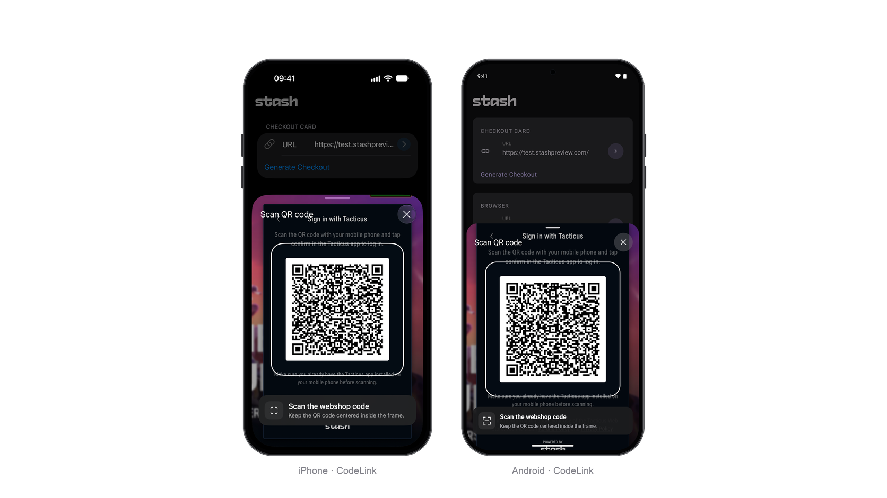

# QR Code Linking

QR Code Linking lets users scan a Stash Webshop QR code in a native card over the host application. Results arrive through [callbacks](#callbacks) for your app to complete account linking.



## Installation

{: .info }
QR Code Linking requires the optional `StashNativeCodeLink` module in addition to the [core SDK](../index.md#package-installation). No additional SDK import is required.

Prebuilt modules are available on [GitHub Releases](https://github.com/stashgg/stash-native/releases). Replace `<tag>` with the release tag you downloaded.

### iOS

Add the `StashNativeCodeLink` library through Swift Package Manager, or add `StashNativeCodeLink.xcframework` with **Embed & Sign**. Set `NSCameraUsageDescription` in your app's Info.plist to explain why camera access is needed.

Custom builds that link static archives directly must pass `-ObjC` to retain the scanner.

### Android

Copy `StashNativeCodeLink-<tag>.aar` into `app/libs/` and add it with its dependencies:

```groovy
dependencies {
    implementation files('libs/StashNativeCodeLink-<tag>.aar')
    implementation 'androidx.camera:camera-camera2:1.4.2'
    implementation 'androidx.camera:camera-lifecycle:1.4.2'
    implementation 'androidx.camera:camera-view:1.4.2'
    implementation 'com.google.zxing:core:3.5.3'
}
```

The module declares the camera permission in its manifest. Source builds use `:stashnative-codelink`.

{: .info }
CameraX 1.4.2 requires Android Gradle Plugin 8.x. For AGP 7.x, including Unity 2022.3 LTS, use **1.3.4** for all three CameraX libraries.

## Open the scanner

Pass the view controller or activity presenting the scanner:

```swift
StashNative.sharedInstance().openScanner(from: self, config: nil)
```

```java
StashNative.getInstance().openScanner(activity, null);
```

The scanner follows the host application's orientation and requests camera access when first opened. QR codes are decoded on the device; no images are saved.

## Configuration

To optionally customize the scanner text or hide its info callout, pass `StashNativeScannerConfig` (iOS) or `StashNative.ScannerConfig` (Android). Empty text values use the defaults.

| Property | Default |
|---|---|
| `headerText` | Scan QR code |
| `calloutTitle` | Scan the webshop code |
| `calloutSubtitle` | Keep the QR code centered inside the frame. |
| `cameraUnavailableText` | Camera unavailable |
| `connectedText` | Connected |
| `showCallout` | `true` |

```swift
let config = StashNativeScannerConfig()
config.headerText = "Escanear código QR"
config.showCallout = false
StashNative.sharedInstance().openScanner(from: self, config: config)
```

```java
StashNative.ScannerConfig config = new StashNative.ScannerConfig();
config.headerText = "Escanear código QR";
config.showCallout = false;
StashNative.getInstance().openScanner(activity, config);
```

## Callbacks

These events go to the shared receiver; see [Setting Callbacks](callbacks.md).

| Callback (iOS / Android) | Fires when |
|---|---|
| `stashNativeDidScanQRCode(_:)`<br>`onQrCodeScanned(content)` | The scanner reads a QR code and closes |
| `stashNativeDidDismissScanner()`<br>`onScannerDismissed()` | The scanner closes without a scan |
| `stashNativeScannerDidEncounterError(_:)`<br>`onScannerError(error)` | The scanner cannot start or access the camera; see [Errors](#errors) |

Use the scanned content to complete [account linking](https://docs.stash.gg/guides/stash-webshop/player-authentication/account-linking#integrate-account-linking) in your app:

```swift
extension StoreViewController: StashNativeDelegate {
    func stashNativeDidScanQRCode(_ content: String) {
        // Use content to complete account linking.
    }
}
```

```java
StashNative.getInstance().setListener(new StashNative.StashNativeListenerAdapter() {
    @Override
    public void onQrCodeScanned(String content) {
        // Use content to complete account linking.
    }
});
```

### Errors

The iOS callback receives an `Error`; its `NSError.code` maps to `StashNativeScannerError.Code`. Android receives `StashNative.ScannerError`.

Camera errors leave the scanner open. A missing module or dependency prevents it from opening and sends no dismissal callback.

| Cause | Error (iOS / Android) | Fix |
|---|---|---|
| Camera access denied | `.cameraPermissionDenied`<br>`CAMERA_PERMISSION_DENIED` | Enable camera access using the scanner's Settings button |
| No camera | `.cameraUnavailable`<br>`CAMERA_UNAVAILABLE` | Offer another way to link |
| Camera setup failed | `.cameraConfigurationFailed`<br>`CAMERA_CONFIGURATION_FAILED` | Retry later |
| Scanner module or Android dependencies missing | `.scannerUnavailable`<br>`SCANNER_UNAVAILABLE` | Complete [Installation](#installation) |
| Camera usage description missing (iOS) | `.missingCameraUsageDescription` | Add `NSCameraUsageDescription` |
| Camera permission removed from the manifest (Android) | `CAMERA_PERMISSION_NOT_DECLARED` | Keep the module's `CAMERA` permission in the merged manifest |

## Other

### Checking state

Check whether an SDK presentation is active. On iOS, read this value on the main thread.

```swift
let isPresented = StashNative.sharedInstance().isCurrentlyPresented
```

```java
boolean isPresented = StashNative.getInstance().isCurrentlyPresented();
```

### Dismissing Scanner

Force dismiss the scanner programmatically:

```swift
StashNative.sharedInstance().dismiss()
```

```java
StashNative.getInstance().dismiss();
```
