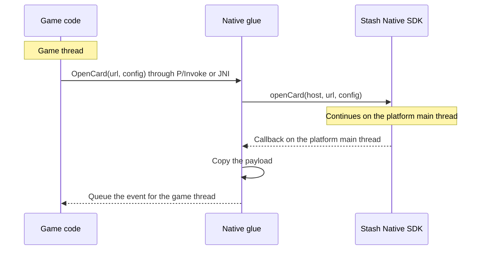

# Engine wrappers

A wrapper adds one native glue file per platform between the engine and the SDK. Official wrappers: [stash-unity](https://github.com/stashgg/stash-unity), [stash-unreal](https://github.com/stashgg/stash-unreal).



## Rules

1. Pass the engine's current activity or root view controller to every open call.
2. Keep the iOS delegate in a strong reference. The SDK holds it weakly.
3. Copy each callback payload and queue it for the game thread. Callbacks arrive on the platform main thread.
4. Forward every callback, in order. Engine pause and resume are not payment results.
5. Check `isCurrentlyPresented` before opening if the game needs a "busy" result. Ignored opens send no callback.
6. Read `isPurchaseProcessing` for processing state. Do not use reflection on SDK internals.
7. Leave orientation to the SDK and `window.stash_sdk` to the page.

## Android

Compile a listener class into the wrapper's Android library:

```java
import android.app.Activity;
import com.stash.stashnative.StashNativeCard;

public final class StashBridge implements StashNativeCard.StashNativeCardListener {
    private static final StashBridge INSTANCE = new StashBridge();

    // Implemented in engine code; queues the event for the game thread.
    private static native void nativeOnEvent(String name, String payload);

    public static void initialize() {
        StashNativeCard.getInstance().setListener(INSTANCE);
    }

    public static void openCard(Activity activity, String url, boolean portrait) {
        StashNativeCard.CardConfig config = new StashNativeCard.CardConfig();
        config.orientationPreference = portrait
                ? StashNativeCard.CardConfig.ORIENTATION_PORTRAIT
                : StashNativeCard.CardConfig.ORIENTATION_FOLLOW_HOST;
        StashNativeCard.getInstance().openCard(activity, url, config);
    }

    @Override public void onPaymentSuccess(String order) { nativeOnEvent("paymentSuccess", order); }
    @Override public void onPaymentFailure() { nativeOnEvent("paymentFailure", null); }
    @Override public void onDialogDismissed() { nativeOnEvent("dismissed", null); }
    @Override public void onPageLoaded(long ms) { nativeOnEvent("pageLoaded", Long.toString(ms)); }
    @Override public void onNetworkError() { nativeOnEvent("networkError", null); }
    @Override public void onExternalPayment(String url) { nativeOnEvent("externalPayment", url); }
    @Override public void onBrowserClosed() { nativeOnEvent("browserClosed", null); }
    @Override public void onQrCodeScanned(String content) { nativeOnEvent("qrScanned", content); }
    @Override public void onCodeLinkError(StashNativeCard.CodeLinkError error) {
        nativeOnEvent("codeLinkError", error.name());
    }
}
```

| Engine | Activity | Callback delivery |
|---|---|---|
| Unity | `UnityPlayer.currentActivity` | `UnityPlayer.UnitySendMessage(gameObject, method, payload)` |
| Unreal Engine | `FJavaWrapper::GameActivityThis` | JNI native method that calls `AsyncTask(ENamedThreads::GameThread, ...)` |

- Implement every listener method in a concrete class. Dynamic proxies may skip default methods.
- Declare the AAR's [dependencies](installation.md#aar) in an External Dependency Manager `*Dependencies.xml` file (Unity) or in UPL `<buildGradleAdditions>` (Unreal).
- Read JNI strings with `GetStringChars`. `GetStringUTFChars` returns Modified UTF-8, which differs for emoji in order payloads.

## iOS

Export C functions from an Objective-C++ file and own the delegate there:

```objc
#import <StashNative/StashNative.h>

typedef void (*StashEventCallback)(const char *name, const char *payload);
static StashEventCallback gCallback;  // Copies the payload and queues it for the game thread.

extern UIViewController *StashEnginePresenter(void);  // Supplied per engine.

@interface StashBridgeDelegate : NSObject <StashNativeCardDelegate>
@end

@implementation StashBridgeDelegate
static void Emit(const char *name, NSString *payload) {
    if (gCallback) gCallback(name, payload.UTF8String);
}
- (void)stashNativeCardDidCompletePaymentWithOrder:(NSString *)order { Emit("paymentSuccess", order); }
- (void)stashNativeCardDidFailPayment { Emit("paymentFailure", nil); }
- (void)stashNativeCardDidDismiss { Emit("dismissed", nil); }
- (void)stashNativeCardDidLoadPage:(double)ms { Emit("pageLoaded", [NSString stringWithFormat:@"%.0f", ms]); }
- (void)stashNativeCardDidEncounterNetworkError { Emit("networkError", nil); }
- (void)stashNativeCardDidRequestExternalPaymentWithURL:(NSString *)url { Emit("externalPayment", url); }
- (void)stashNativeCardDidCloseBrowser { Emit("browserClosed", nil); }
- (void)stashNativeCardDidScanQRCode:(NSString *)content { Emit("qrScanned", content); }
- (void)stashNativeCardCodeLinkDidEncounterError:(NSError *)error {
    Emit("codeLinkError", [NSString stringWithFormat:@"%ld", (long)error.code]);
}
@end

static StashBridgeDelegate *gDelegate;  // Strong owner.

extern "C" void StashBridgeInitialize(StashEventCallback callback) {
    gCallback = callback;
    dispatch_async(dispatch_get_main_queue(), ^{
        if (!gDelegate) gDelegate = [[StashBridgeDelegate alloc] init];
        [StashNativeCard sharedInstance].delegate = gDelegate;
    });
}

extern "C" void StashBridgeOpenCard(const char *url, bool portrait) {
    NSString *checkoutURL = url ? [NSString stringWithUTF8String:url] : nil;
    dispatch_async(dispatch_get_main_queue(), ^{
        StashNativeCardConfig *config = [[StashNativeCardConfig alloc] init];
        config.orientationPreference = portrait ? StashNativeOrientationPreferencePortrait
                                                : StashNativeOrientationPreferenceFollowHost;
        [[StashNativeCard sharedInstance] openCardWithURL:checkoutURL
                                       fromViewController:StashEnginePresenter()
                                                   config:config];
    });
}
```

| Engine | Presenter | Callback delivery |
|---|---|---|
| Unity | `UnityGetGLViewController()` | `UnitySendMessage(gameObject, method, payload)` |
| Unreal Engine | `[IOSAppDelegate GetDelegate].IOSController` | Copy into an `FString`, then `AsyncTask(ENamedThreads::GameThread, ...)` |

- `StashNative.framework` is dynamic. Embed and sign it. Unreal: `PublicAdditionalFrameworks.Add(new Framework("StashNative", path, null, true))`.
- The example uses ARC. Unreal compiles Objective-C without ARC unless the module sets `bEnableObjCAutomaticReferenceCounting = true`. The SDK supports both modes.
- `UTF8String` buffers are autoreleased. Copy them before the callback returns.

## Platform differences

| Behavior | iOS | Android |
|---|---|---|
| `isCurrentlyPresented` during `openBrowser` | `true` | `false` |
| `isCurrentlyPresented` during external payment | `true` until Safari closes | `false` |
| `openBrowser` while a card is open | Ignored | Opens |
| Open call inside a payment callback with `autoClose` | Ignored | Accepted |
| `closeBrowser()` | Closes Safari | No effect |
| Page loaded duration | Presentation start to first finished load | Last navigation start to the end of the loading fade |
| `stash-pay` deep link in a new window | Payment result | Opened by the OS |
| Portrait backdrop, keep-alive service | Not available | Available |
| Browser orientation, closing Safari with a result | Available | Not available |
