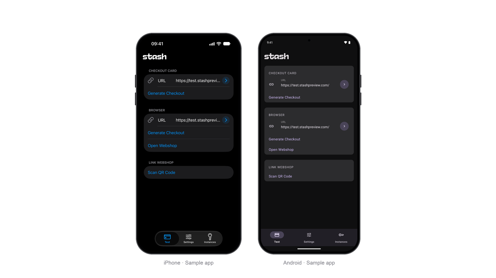

# Sample Apps

Sample apps are not included in the distributed packages. Clone or download the [Stash Native repository](https://github.com/stashgg/stash-native) and follow the instructions below to build the native iOS and Android samples.

```sh
git clone https://github.com/stashgg/stash-native.git
```

The samples are native Android / iOS apps. The [Unity](https://github.com/stashgg/stash-unity) and [Unreal Engine](https://github.com/stashgg/stash-unreal) bindings include their own sample scenes as part of the package.



## iOS

Open `iOS/Sample/StashNativeSample/StashNativeSample.xcodeproj` in Xcode 27.1, choose a simulator, and run the `StashNativeSample` scheme. To run on a device, set your team and a bundle identifier of your own under **Signing & Capabilities**.

## Android

With JDK 17 installed and `ANDROID_HOME` pointing to the Android SDK, run from `Android/`:

```sh
./gradlew :sample:installDebug
```
{: .platform-android }

This builds the sample and installs it on the connected device or emulator. You can also open `Android/` in Android Studio and run the `sample` configuration.
